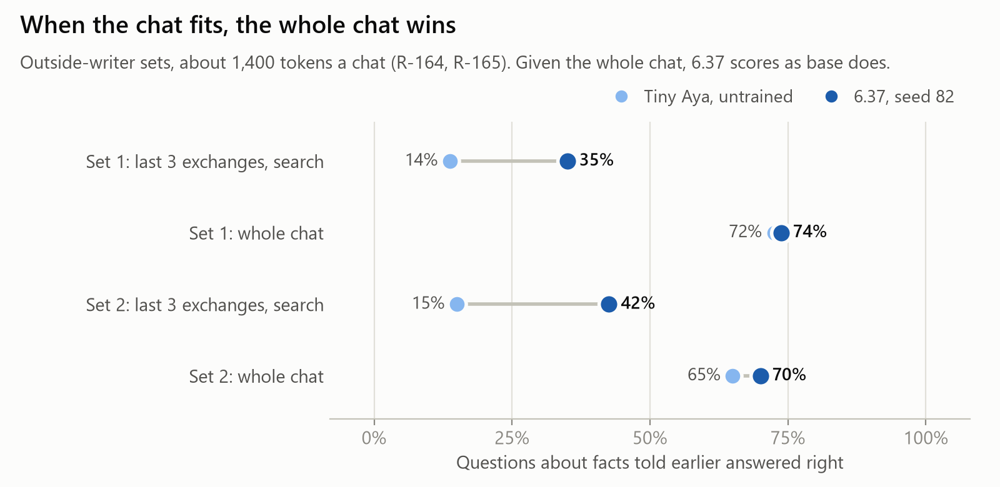
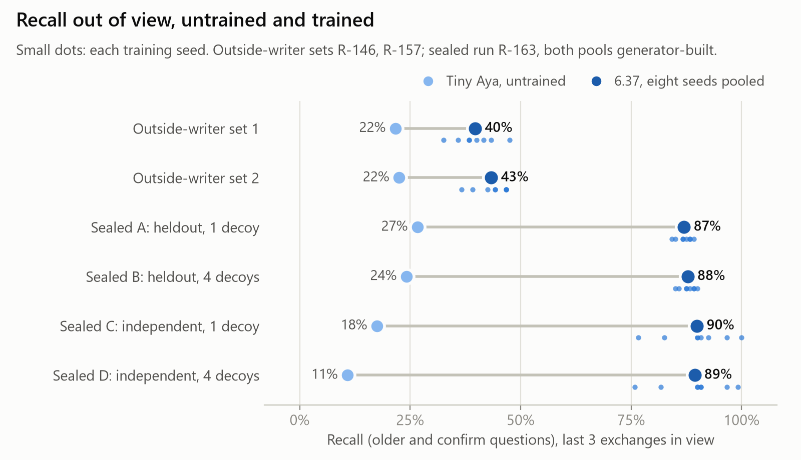

# Teaching a 3B model to search a long chat it can no longer see

*Kevin Vaillancourt · Lexsi AI Safety and Alignment Hackathon, Track 3 (Agentic Fine-tuning) · November 2026*

> **{{status_line}}**

## Abstract

When a chat fits in what the model can read, give it the whole chat. On two sets of chats written
by outside writers who never saw this project's generator (about {{ow_tokens_mean}} tokens a chat),
untrained Tiny Aya Global (3.35B) with every message in view answers {{wc_base_older_1}} and
{{wc_base_older_2}} of {{older_n}} questions about facts told earlier. Our trained model, 6.37, with
a search tool and only the last three exchanges in view, answers {{tool82_older_1}} and
{{tool82_older_2}} (R-164). Given the whole chat and the tool, 6.37 and the untrained model show
no measured difference (one seed, two sets of {{ow_chats}} chats; gaps under about {{kind_noise}} points on a kind of {{kind_noise_n}} questions could not be seen, R-142) on every kind
of message (R-165). So the gain below is for chats too long to show whole.

For those chats, 6.37 is a LoRA adapter trained to search the earlier conversation when the answer
is out of view, to read what comes back, and to answer in the model's own voice. With only the last
three exchanges in view, as a stand-in for a chat too long to show, the shipped seed answers
{{ow_82_recall_1}} and {{ow_82_recall_2}} of {{ow_recall_n}} recall questions on the two
outside-writer sets, against the untrained model's {{ow_base_recall_1}} and {{ow_base_recall_2}}
(gain {{ow_82_int_1}} and {{ow_82_int_2}} points, 95% intervals resampling chats; on the first set
the sign test gives p = {{ow_82_p_1}}, above the registered 0.01) (R-146, R-157). The gain is on
facts asked about directly. On "..., right?" questions that make a false claim, 6.37 corrects
{{claims_82_corrected_1}} and {{claims_82_corrected_2}} of {{claims_false_n}} and goes along with
the rest (R-164). The shipped seed, 82, is the lowest of the eight training seeds on the first
outside-writer set, on sealed conditions C and D, and on `hard_dev`; the eight seeds pooled gain
{{ow_seeds_diff_1}} and {{ow_seeds_diff_2}} points on the two sets ({{ow_seeds_int_1}} and
{{ow_seeds_int_2}}) (R-141, R-146, R-157, R-163). The outside writers are {{ow_writers}} fresh
Claude Opus agents a set, and the coherence judges are Claude Sonnet agents only, never checked
against a person. On the registered sealed test, run once on the untrained model and all eight
training seeds in four conditions, every registered rule passes: recall {{sealed_adapters_range}}%
pooled over the eight against the untrained model's {{sealed_base_range}}%, every right answer from
a search that found the fact, no adapter with more false retrievals than the untrained model, and
every adapter judged coherent more often (R-163). Both sealed pools come from the project's own
generator. Not measured: the untrained model reading the whole chat at 419 messages.

## 1. Introduction

A chat assistant keeps a long conversation, but a model attends to a limited window. Tiny Aya Global
takes at most {{model_max_tokens}} tokens, and {{model_full_layers}} of its {{model_layers}} layers
attend to all of them; the other layers attend to the last {{model_window}} (the model's config).
Past that, a fact told early in the chat is either out of the prompt or in a part most layers do
not see.

**The first answer is to show the whole chat when it fits.** We measured it late, after the
sealed run (R-164, R-165), and it changes how the rest of this paper should be read. On chats of
about {{ow_tokens_mean}} tokens, the untrained model with every message in view beats our trained
model working from the last three exchanges and a search, by a wide margin (section 6). Given the
whole chat as well, the trained model and the untrained one show no measured difference (one seed, two sets of {{ow_chats}} chats; gaps under about {{kind_noise}} points on a kind of {{kind_noise_n}} questions could not be seen, R-142) on every kind. The design
this supports is plain: show the model the whole chat when it fits, and let it search when it does
not.

**What the trained model adds** is the second half: a model that, shown only the last part of a
chat, decides when an answer is out of view, writes a search, reads the result and answers without
sounding different from before. We test it with the last three exchanges in view, as a stand-in for
a chat too long to show. It beats the untrained model there on every test set: on the
outside-writer sets by {{ow_82_diff_1}} and {{ow_82_diff_2}} points ({{ow_82_rel_1}} and
{{ow_82_rel_2}} over base; R-146, R-157), and by {{sealed_gain_range}} points on the generator's
sealed pools (sections 7 and 8).

The Track 3 statement asks for a model that "decides when and what to retrieve, grounds its answers
in the retrieved text and ignores distracting documents". Each phrase maps to a measure here:

| Track statement | Measure |
|---|---|
| decides **when** to retrieve | right decisions: searched exactly when the answer was out of view |
| decides **what** to retrieve | the fact was found by the model's own query |
| **grounds** its answers | recall: the right fact in the reply, counted again on retrieved answers alone |
| **ignores distracting documents** | false retrieval: a decoy's fact in the reply, with one and four decoys a chat |

**Contributions.**
1. A measured answer to "why not show the whole chat": on short chats, do; given the whole chat,
   the trained model and the untrained one show no measured difference (R-164, R-165; one seed,
   two sets of 40 chats).
2. A training recipe that teaches the search habit while keeping the model's own voice (section 4).
3. A test that is hard to game: registered before training, amended only to make it harder, frozen
   with its scorer and judge, run once on every training seed (R-016, R-038, R-039, R-041, R-154,
   R-162), and two sets of chats by writers who never saw the generator.
4. A ledger of every candidate tried, with the line each failed (section 10), and three toolkit
   findings (section 11).

## 2. Related work

Tool use can be learned from demonstrations of when a call helps (Toolformer, Schick et al., 2023)
and interleaved with reasoning (ReAct, Yao et al., 2023). Adaptive retrieval asks when to retrieve
at all: popular facts are answered from memory, rare ones looked up (Mallen et al., 2023), and
Self-RAG trains a model to decide and to critique its own retrievals (Asai et al., 2024). RAFT
fine-tunes on retrieved sets that include distractor documents, so the model learns to cite the
right one (Zhang et al., 2024); our decoys play the same role inside a conversation. For long
chats, MemGPT manages memory with an agent loop around the model (Packer et al., 2023), and
LongMemEval measures long-term chat memory (Wu et al., 2025); models also use the middle of long
contexts poorly (Liu et al., 2024), which is one reason to keep the window short and search
instead. Training on a model's own outputs that pass a check follows STaR (Zelikman et al., 2022).
Coherence is judged by a model, as in LLM-as-a-judge evaluation (Zheng et al., 2023), but blind to
which model wrote each reply. Adapters are LoRA (Hu et al., 2022).

## 3. Task and pools

A conversation has run for some time. In the main tests the model sees the system prompt, the last
three exchanges and the friend's newest message. Everything earlier sits behind one tool,
`search_corpus`, a full-text search over the earlier conversation that returns the top {{top_k}}
passages, one passage per exchange; the model may call it up to {{max_calls}} times a turn. The
newest message is one of five kinds, each scored by a fixed rule (`src/aya_retrieval/scoring.py`,
R-015):

| Kind | Example | Scored right when |
|---|---|---|
| `older`: fact told long ago | "drawing a blank on my daughter's tattoo" | the reply names the answer and no listed wrong value |
| `confirm`: "did I tell you…?" | "did i say anything about my godfather's tattoo" | the same; saying it was never told is wrong |
| `in_view`: fact still in view | "what language does Chidi speak" | the same |
| `never_told` | "did i ever bring up what my mentor grows" | the reply names no value of that type |
| `statement`: just chatting | "i got stuck talking to Lucia for an hour" | the model makes no search (the reply's words are not scored) |

`older` and `confirm` together are **recall**, the registered primary measure (R-016). Every chat
also holds **decoys**: the same type of fact about other people ("my classmate is scared of heights"
beside "my tutor is scared of spiders"), so a search can bring back the wrong person's fact.

**Pools.** Generated conversations are built from pools of people, relations, fact types and small
talk that share no content; tests enforce it (README, Pools).

| Pool | Written by | Used for |
|---|---|---|
| `train`, `wide` | Claude; `wide` by a fresh agent from a brief | training (R-015, R-069) |
| `probe` | Claude | development screens and confirmations |
| `hard_dev` | a fresh agent, from the sealed pool's brief | development: a readable twin of `independent` (R-066) |
| `heldout` | Claude | the sealed test only (conditions A and B); run once (R-162) |
| `independent` (generator-built, sealed) | a fresh agent, from a brief; never read | the sealed test only (conditions C and D); run once (R-039, R-162) |

The generated tests use chats of 58 and 419 messages. A development run holds 24 conversations of
each kind at each size; a sealed condition holds 30, {{sealed_conversations}} in all.

**The outside-writer sets** are different in kind. Each is {{ow_chats}} chats with {{ow_items}}
questions, written by {{ow_writers}} fresh Opus agents from one behaviour brief, with no access to
the generator, its pools or any result, and frozen by SHA-256 before anyone read a chat (R-142,
R-143, R-152). The chats have 20 to 30 exchanges and about {{ow_tokens_mean}} tokens (at most
{{ow_tokens_max_1}}). Half the `confirm` questions claim a wrong value, so agreeing with the user
cannot pass (R-142). They are tag questions: a count of the `confirm` messages finds a tag
("right?", "yeah?", "isn't it" and the like) in {{tags_1}} on set 1 and {{tags_2}} on set 2, ending
the message in {{tags_end_1}} and {{tags_end_2}} (the rest carry it mid-message, before a further
sentence; R-153 found all 40 on set 1 to be tags). A
loader turns each question into the same harness item as every other test (R-142). The first set
(`data/blind_dev/`) was registered as report only and became a development set when 7 was designed
from its failures (R-151); the second (`data/blind_dev2/`) was written after 6.37 was fixed and was
read by no decision that changed 6.37 (R-152, R-157). It was 7's judge (R-151, R-153), and the
freeze panel's lane cited it in arguing for the freeze (R-159).

## 4. Method

**The loop.** The model's turn either answers or calls `search_corpus`; the harness runs the search,
returns the passages, and the model answers from them, up to {{max_calls}} searches a message
(`src/aya_retrieval/harness.py`). Decoding is greedy.

**6.37's training set** ({{training_file}}, {{training_rows}} rows: {{training_kinds}}) was built in
steps, each recorded before it trained:

- *Targets in the model's own voice* (R-016, R-020). Where the untrained model's reply passes the
  scorer, that reply is the target; where a search is needed, the row shows a clean call with the
  demonstrated query, the tool's real output and then the answer, and if the real search missed the
  fact the answer says it does not know. Decoy counts vary per row (0 to 2 for recall rows, 1 to 3
  for `never_told`), because the first adapter learned that the number of passages gave the answer
  away (R-018, R-020).
- *Plain chat* (R-055 to R-061). More plain-chat lines; their targets are the untrained model's
  replies when asked to be brief, vetted by a blind judge on the coherence rubric (v5).
- *Loss on what is taught* (R-076, R-077, R-088, R-092, R-093). Until v5, TRL's default put the loss
  on every token of a row, scripted small talk included. Loss now falls on the taught turns, and on
  plain-chat rows only on the reply's first token and its end-of-turn marker, so the reply's words
  stay the model's own (17m, v6).
- *Stricter plain-chat targets* (R-078 to R-080): two judges re-vetted the targets on a rubric that
  names reading a complaint as good news, a wrong name and an invented event.
- *Who-is-who answers* (R-094 to R-098, R-105): answers that pinned the friend's relation on the
  wrong person were rewritten in the form "Your {relation} {person} ...", with replacements first
  passed by CuratorKIT's grounding gate.
- *Corrections and an earlier question in view* (R-102, R-104): 170 train-pool rows where a fact is
  corrected later, with cue controls, and rows with an earlier question still in view. Built from
  6.1 to 6.2 (R-105 to R-109), trained from scratch.
- *Statements and indirect questions* (R-114, R-117): chat lines that name a fact type answered
  without a search, questions asked as statements answered from one with the pool's scripted
  answer, and contrast lines where someone else forgets or loses something, answered without a
  search (6.31).
- *Removals* (R-122 to R-127): 6.37 is 6.31 less 9 of those contrast lines (the lost wallet, the
  forgotten umbrella, lost track of time), which went with one missed probe question.

No row comes from `probe`, `hard_dev`, either outside-writer set or a sealed pool. Several rows were
designed after reading failures on development pools, so those pools are development evidence for
6.37, not tests of it (R-117, R-122, R-128).

**Training.** {{training_setup}}. Through AgentTune's distillation trainer (TRL underneath). Eight
training seeds (82, 83, 94 to 99) were trained on the same set; seed 82 was named to ship before
seeds 94 to 99 or any outside-writer chat existed (R-114, R-141), and is the frozen model (R-160).
Training took {{train_minutes}} minutes a seed, peaking at {{train_peak}} GiB of card memory.

**The Lexsi toolkits.** AgentTune trains every adapter (R-003, R-016). AuditKIT re-scored recorded
replies as a second scorer during development: its files are {{auditkit_runs}} (R-030, R-031); no
AuditKIT run on 6.37 exists. CuratorKIT's grounding gate audited v6's found-fact training answers
and passed the replacements before they were used (R-096, R-098). Section 11 reports what each
showed.

## 5. Evaluation protocol

**Registration.** R-016 registered the test before any recall adapter existed: base and adapters on
identical held-out conversations, 30 per kind at each of 58 and 419 messages, greedy, run once.
Three amendments, each made before any held-out run and each only adding requirements: four decoys
a chat as a second condition and false retrieval as a gated measure (R-038); a second sealed pool,
`independent`, written by a fresh agent and never read (R-039); and the recall rule must also hold
when only retrieved answers count (R-041). R-020 changed one thing in every pool before any was
read: `never_told` questions use the `confirm` wording half the time, so a `confirm` wording does
not mean the fact exists.

**The freeze.** The scorer, the sealed pools, the judge's brief and rubric, the human check and the
adapter's weights were hashed into `results/freeze/sealed_manifest.json`, the judge pinned to
`claude-sonnet-5-5` (R-154, R-160). The sealed run began with a check of that manifest and ended
with a check of every judge's transcript (R-162, R-163).

**The sealed run** (R-162). Four conditions, each run once, base and all eight 6.37 seeds on the
same {{sealed_conversations}} conversations, item seed 90311:

| Condition | Pool | Decoys a chat | Added by |
|---|---|---|---|
| A | `heldout` | 1 | R-016 |
| B | `heldout` | 4 | R-038 |
| C | `independent` (generator-built, sealed) | 1 | R-039 |
| D | `independent` (generator-built, sealed) | 4 | R-039 |

Rules, every one in every condition: (1) recall pooled over the adapters at least 20 points above
base at each size, with a paired exact sign test below 0.01; (2) rule 1 again on retrieved answers
only; (3) each adapter's false retrievals no more than base's; (4) each adapter's coherent count at
or above base's, on all 300 conversations in A and a fixed sample of 120 in B to D.

**Coherence.** A judge sees the turns in view, the newest message and a reply, and marks 1 if the
reply "is a sensible next turn: it responds to the newest message, fits what was said in the turns
shown, reads as ordinary language, and does not contradict or deny anything said there"
(`coherence.RUBRIC`). Each sheet shuffles every model's reply to the same conversations with the
names removed, so one judge marks base and every adapter (R-090, R-162). Three fresh judges mark
each sheet; judge 1 decides and judges 2 and 3 are reported. Every judge's transcript was audited
(model, folders touched, commands run, every line marked) before its marks were filed
(`scripts/records/audit_judge_r162.py`, R-163). Measured spread: R-128's three judges split on
{{judge_spread}} (R-154). **The judges were never checked against a person.** The human checks check
the recall scorer: {{human_check}}. In every disagreement the scorer was the stricter; the two lines
both people passed and the scorer failed name the answer and a wrong value together (R-144, R-145).

**Statistics.** Paired exact sign tests on the questions where two runs differ, and 95% percentile
bootstrap intervals that resample whole conversations or chats, keeping the pairing. The adapter
pairs in rule 1 share conversations, so its p-value overstates independence; the whole-conversation
interval is the figure to read (R-162). Generated questions share fact templates: the development
pools' recall questions come from {{probe_templates}} templates (`probe`) and {{hd_templates}}
(`hard_dev`), so item-level p-values there overstate the evidence (R-141). The sealed pools' template
count is not known without opening them, which this project's rules forbid, and the sealed intervals
do not resample templates (R-164).

**Every deviation from the registered plan, in one place.**
1. *Eight seeds, not three.* R-016 named three adapters; the sealed run used all eight trained on
   6.37's set, at Kevin's word, so no seed was chosen after a result (R-162). Rule 1 on R-016's own
   three seeds (82, 83, 94) is in section 7 and is met in every condition.
2. *A brief's word count* (R-163, disclosure 1): the judges' brief named "two files" instead of
   "these five files", to match the files given.
3. *The judge audit tightened during condition A* (R-163, disclosure 2): counting commands were
   allowed; one judge's command was read and filed by hand.
4. *A duplicate line in the judge list* (R-163, disclosure 3), removed before the record.
5. *Fields added to the scorer after the run* (R-163, disclosure 4): reported fields only; every
   earlier value unchanged, no rule changed.
6. *The first outside-writer set became a development set* (R-151), when 7 was designed from its
   failures. 6.37's result on it was measured before that.
7. *R-016's references were not run.* R-016 lists `whole_chat` and `always_search` as references
   to report beside the rules; R-162 ran neither and did not say so, and the omission was first
   disclosed in R-167. The pass rules did not depend on them. The whole-chat reference was run
   afterwards, on the outside-writer sets only (R-164, R-165); `always_search` was never run on a
   set the trained model was tested on (section 6).
8. *No exact interval on the coherence difference.* R-016 asks for the paired disagreement counts
   and an exact 95% interval on the coherence difference; R-163 reports counts per model only
   (R-167).
9. *The training recipe differs from R-016's.* R-016 registered LoRA r = 16 on the attention
   projections, learning rate {{r016_lr}} and {{r016_rows}} rows (R-016, R-018). 6.37 is rank
   {{ship_rank}} on all {{ship_targets_n}} projections, learning rate {{ship_lr}},
   {{training_rows}} rows, with the loss on the taught turns only (R-044, R-046, R-052, R-076,
   R-127). Each change has its own record; none was listed as a deviation before R-167.
10. *LoCoMo* was registered as an outside check (R-100), deferred (R-139 item 6) and never run
    (R-167).

## 6. Results: whole chat or search

On the outside-writer sets, `older` questions (R-164, R-165; one seed, 40 chats a set; in brackets,
the paired counts against base with the whole chat):

{{wc_older_table}}

Base with every message in view beats 6.37 working from the last three exchanges on both sets
(set 1: {{wc_vs_tool_1}}; set 2: {{wc_vs_tool_2}}; R-164). Given the whole chat, 6.37 and base
show no measured difference (one seed, two sets of {{ow_chats}} chats; gaps under about {{kind_noise}} points on a kind of {{kind_noise_n}} questions could not be seen, R-142), with or without the tool (R-165): no measured damage to how the model uses the context it
can see.

Every kind, base with the whole chat and no tool (`whole_chat_all`) against 6.37 with the whole chat
and the tool (`whole_chat_tool`), with both models' scores from the last three exchanges beside
them (R-165):

{{wc_kind_table}}

No kind differs near significance (smallest p = {{wc_min_p}}). The largest gap is `statement` on
set 2, {{wct_statement_2}} for 6.37: {{wct_statement_searched_2}} needless searches, where base
cannot search at all. With the whole chat in view the trained model searches far less on `older`
and `confirm`, but still searches about half the `never_told` questions: {{wc_searches}}. On set 2,
`never_told` falls to {{wct_never_told_2}} and `confirm` to {{wct_confirm_2}} with the whole chat,
against {{tool82_never_told_2}} and {{tool82_confirm_2}} from the last three exchanges; base with
the whole chat is as low ({{wca_never_told_2}} and {{wca_confirm_2}}), so the drop comes with
having the whole chat in view, not with training (R-165).

Tokens read per turn: {{wc_tokens}} (R-164; whole-chat-and-tool from the raw runs). On chats this
short, reading the whole chat costs fewer tokens than searching, not more.

**What is not measured.** Base with the whole chat on the generated pools, whose 419-message chats
run about {{hd_419_tokens}} tokens on `hard_dev` and {{probe_419_tokens}} on `probe`. Those runs were
registered (R-164) and have no results, because they ran out of card memory (R-166; the queue log is
`results/control/R-164/wc_hd_base_oom.log`). The `hard_dev` run failed {{oom_hd_tries}} tries with
`torch.OutOfMemoryError`: it asked for {{oom_hd_more}} GiB more with {{oom_hd_allocated}} GiB already
allocated and {{oom_allowed}} GiB allowed, the cap these runs use (`--max-vram-fraction 0.85` of a
10 GB card, `scripts/records/queue/wc.sh`). The `probe` run failed the same way on its first try
({{oom_probe_more}} GiB more, {{oom_probe_allocated}} allocated); it was started {{oom_probe_started}}
times, tries 2 and 3 show no error line in the log, and try 3 shared the card with another run and
was stopped (R-166). Both pools hold 58- and 419-message
chats, and R-166 reads the failure as the whole 419-message chat not fitting under the cap. With the
three-exchange view, every run in the sealed run, base and adapters, peaked at {{sealed_peak_range}}
GiB on chats of the same two sizes (R-163). Earlier whole-chat runs at 419 messages, before any cap,
peaked at {{r014_peak}} and {{r017_peak}} GiB, more than the card holds (R-014, R-017); 6.37's
whole-chat runs on the outside-writer sets peaked at {{wc_ship_peak}} GiB.

The only whole-chat readings at 419 messages are two development runs on the training pool, both
uncapped, and neither is a ceiling. R-014: {{r014_whole_chat_419}} right at 419 messages against
{{r014_whole_chat_58}} at 58, ruled not valid because most replies copied the repeated scripted small
talk. R-017, after the small talk was varied: {{r017_wc_419}} `older` questions right at 419 messages
against {{r017_wc_58}} at 58, failing its own control. A low score at 419 messages agrees with the
model's sliding window but does not show it is the cause (R-017, R-164).

**Code that always searches is a competitor for long chats, and was not tested against.** R-014's
`always_search` arm (code makes a search on every turn and hands base the result; no training)
answered {{r014_always_search_419}} at 419 messages, against the whole chat's
{{r014_whole_chat_419}}, and {{r014_always_search_58}} at 58. It has a cost: in R-017 it answered
{{r017_always_search_in_view}} facts in view (base with no tool {{r017_three_exchanges_in_view}}) and
{{r017_always_search_statement}} plain-chat lines without a search (base with no tool
{{r017_three_exchanges_statement}}), because it searches on every turn. R-016 registered it as a
reference; it was never run on any set the trained model was tested on (R-167, item 1).

## 7. Results: the sealed run

Every rule passes in every condition (R-163). Recall, rule 1 (counts of right answers, `older` and
`confirm`):

{{sealed_rule1_table}}

The gain is {{sealed_gain_range}} points at each size against the 20 required; the registered sign
test is met in every condition, p below 0.01. Base is low here ({{sealed_base_range}}%), so ratios
over it are unstable and are not given. **Rule 2** (R-041): every right adapter answer came from a
search that found the fact, and so did every right base answer, so rule 2's numbers equal rule 1's
in every condition.

**Rule 3**, false retrievals (a reply naming a wrong value of the fact asked about):

{{sealed_false_table}}

**Rule 4**, coherent replies (judge 1 decides; judges 2 and 3 reported). Every adapter is above base
under every judge:

{{sealed_coherence_table}}

Base here has the search tool in its prompt; R-017 found the tool alone lowers the untrained
model's ordinary talk, so rule 4 compares with that base. In development, 6.37 was also judged
against base with no tool on plain chat and facts in view, and was at or above it (R-128, R-130).

**R-016's three seeds.** Rule 1 recomputed on seeds 82, 83 and 94, the test as first registered:

{{sealed_r016_table}}

**Seed 82 beside the eight.** Recall of {{sealed_recall_n}} for each seed (82, 83, 94 to 99):
{{sealed_per_seed}}. Seed 82 against base: {{sealed_ship_by_condition}}; its sign test is below 0.01
in each. On `heldout` it is level with the other seeds. On `independent` it is the lowest of the
eight, most of all on `confirm` ({{sealed_ship_confirm}}, against up to
{{sealed_ship_confirm_top}}): it {{sealed_ship_found_cd}}, so most misses there are facts it found
and did not use (R-163).

**`older` and `confirm` apart** (of {{sealed_per_kind_n}} a model; pooled of 480):

{{sealed_split_table}}

**The other kinds** (of {{sealed_per_kind_n}}):

{{sealed_kind_table}}

Below base, in the sealed run: on `in_view` in `heldout`, {{sealed_in_view_below}} adapter runs
score below base, so some seeds lose a few questions whose answer is in view (R-163); every kind
where any seed is below base is listed at the end of section 8.

**Behaviour**, reported beside the rules (of 300; clean first calls are calls with nothing written
after them):

{{sealed_behaviour_table}}

## 8. Results: the outside-writer sets

Recall (`older` and `confirm`, of {{ow_recall_n}}) with the last three exchanges in view (R-146,
R-157, R-164):

{{ow_recall_table}}

On set 1 seed 82's gain is {{ow_82_diff_1}} points and its sign test p = {{ow_82_p_1}}, above the
registered 0.01; it is {{ow_82_place_1}} on that set. On set 2 it is {{ow_82_diff_2}} points, p =
{{ow_82_p_2}}. The eight seeds pooled gain {{ow_seeds_diff_1}} and {{ow_seeds_diff_2}} points. Both
sets' gains are far below the generator's: on `hard_dev` the same seed goes from {{hd_base}} to
{{hd_82}} of {{hd_n}} (R-141, R-164). The eight seeds are runs over the same questions, not
independent cases (R-137). Each set has only {{ow_writers}} writers, all one model family, and the
intervals resample chats, not writers (R-142):

{{ow_writer_table}}

Seed 82 is above base in every writer's chats on both sets.

**Each kind** (R-146, R-157):

{{ow_kind_table}}

The gain is nearly all `older` ({{ow_older_1}} and {{ow_older_2}}). On `confirm` seed 82 is below
base on set 1 ({{ow_confirm_1}}) and above on set 2 ({{ow_confirm_2}}). On `statement` it is below
base on both sets ({{ow_statement_1}}, {{ow_statement_2}}): it searched on chat lines where base did
not (R-146, R-157).

**Every kind where seed 82 or any seed is below base** (outside-writer sets and sealed run, counts
of right answers; R-146, R-157, R-163): {{below_base}}.

**Tag questions.** Half the `confirm` questions claim the right value and half a wrong one (R-142).
6.37 rarely searches a tag question (set 1: {{ow_confirm_searched_1}}; set 2:
{{ow_confirm_searched_2}}) and mostly agrees with the claim:

{{ow_claims_table}}

So seed 82 goes along with most false claims: it corrects {{claims_82_corrected_1}} and
{{claims_82_corrected_2}} of {{claims_false_n}}, about as often as base. This is a result, not only
a limit. 7.1, trained to search tag questions, searched nearly all of them and grounded every right
answer, but did not raise recall and failed a development line (R-157, R-158).

**The prompted baseline.** Two fixed system prompts on base, written before any result: A states
five rules, B adds four worked examples (R-137, R-161). Recall:

{{ow_prompt_table}}

Both prompts lower base's recall on both sets: they make base search less. For these two prompts, a
written prompt does not buy the gain. A search over prompts was not tried.

**Where seed 82's wrong answers go wrong** (R-139's stages, R-146, R-157):

{{ow_stage_table}}

The leading stage on both sets is a search that missed the fact. Read by hand (R-146): a tag
question does not trigger a search; queries reuse training wording ("aunt keeps animals yard") and
miss; a fact told with a pronoun ("she has a cockatiel") cannot be matched by a search for the
relation; and a found fact is answered from the line's first clause. On set 1, most misses state
something false, usually another person's fact from the found passage (R-146); on `hard_dev` almost
none did (R-144). The scorer checks only the answer on questions whose writer listed no wrong value;
on the questions that list one, seed 82 gets {{ow_wrongvals_1}} (set 1) and {{ow_wrongvals_2}}
(set 2) (R-143, R-152).

## 9. Cost

The sealed run's times, on this machine (an RTX 3080, 10 GB, each run with the card to itself)
(R-163):

{{cost_table}}

Seed 82 reads {{cost_share}}% of the whole chat's tokens a turn and writes fewer tokens than base.
It takes longer per conversation than base because it searches more often, and each search adds a
model call. Peak card memory in the sealed run was {{cost_peak}} GiB. The {{judges_n}} judges took
{{judge_times}} (`results/coherence/R-162/judge_times.json`). Training took {{train_minutes}}
minutes a seed. On the outside-writer sets the comparison runs the other way: a chat of about
{{ow_tokens_mean}} tokens costs less to read whole than to search (section 6).

## 10. How 6.37 was chosen: the candidate ledger

Every candidate after v5, in order, with the line it failed. The records number the candidates read
at seeds 82 and 83 since v6 (R-093); by that count 6.37 is candidate {{ledger_ship_n}} and 7.1 is
the {{ledger_since_n}}th (R-127, R-134). Fix B was run in that time and is outside the records'
count. Before v6, {{ledger_before_n}} candidates were screened against v5. Screen recall is the
development screen (`probe`, seed 51203) at training seed 82; `hard_dev` is seed 73157 at seed 82;
both are development numbers, read many times.

**Before v6** (v5 stands until 17m):

{{ledger_before}}

**Since v6** (from R-103 on, Kevin's tree names: 6.1 is v6 plus a first stepping stone, 6.11 a second
on top of it, 6.2 a different first stone):

{{ledger_since}}

Not counted as candidates: the scaled and mixed 17b adapters of R-090, registered as diagnostics,
not shippable models (R-088); the controls `fix17crx` and `fix17cs2x`, reported only (R-106,
R-115); fix 15b and 6.35, registered and never trained (R-075, R-122). Trained and scored, with no
record reading the result: {{ledger_unread}}. The {{ledger_total}} counted here are trained candidate
sets: {{ledger_before_n}} before v6 (17m included), {{ledger_since_rows}} since (fix B included) and
these {{ledger_unread_n}}. Listed but not counted: base and v5 (reference rows), the controls
`fix17crx` and `fix17cs2x`, and R-090's diagnostics.

What the ledger shows. Probe recall sits at its ceiling, so a copy with no real defect often misses
one question by chance, and each removal copy from 6.33 to 6.36 fell short of v6's probe recall
(R-123 to R-127). `hard_dev` recall moves between training seeds alone ({{hd_seed_range}} of 96 for
6.37, R-141) by more than most changes moved it. Later panels judged that a
further candidate could not be told from a draw (R-150, R-159). The gates did not move; 6.37 is the
only copy after v6 that passed every registered line.

## 11. Toolkit findings

**AuditKIT's paired bootstrap does not centre its resamples.** It reports a large gain as not
significant: on this project's data it did so for {{auditkit_bug_example}} (R-031; the value it gave
and a reproduction are in the defect note). It is shared by AuditKIT's model comparison, run comparison and experiment significance. We use the
exact sign test and a centred bootstrap instead; the defect, a reproduction and a one-line fix are
in [`docs/auditkit_bootstrap_defect.md`](auditkit_bootstrap_defect.md). As a second scorer on v3,
AuditKIT's whole-word oracles agreed with ours on {{auditkit_agree}} cases (R-031,
`results/audit/v3_probe73157.json`). Runs on fix 5c and v5 exist in `results/audit/`; no record reads
the v5 file. AuditKIT was not run on 6.37.

**TRL's chunked loss copies the output layer for every chunk.** Training first peaked at
{{mem_before}} GiB on a 10 GiB card, so any other program on the card pushed it into shared memory
at several times the step time. The loss computes `h.float() @ w.float().t()`; under bf16 autocast
both float32 copies of the {{model_vocab}}-word output layer are cast straight back to bf16, so they change
nothing but memory. A replacement that takes the bf16 product directly gives TRL's loss, scores and
gradients bit for bit (tested), and training peaks at {{mem_after}} GiB at about {{step_seconds}} s
a step. Retrained with it, v3 differed from its original on {{lean_retrain_diff}} conversations,
inside run-to-run variation (R-029, R-032). 6.37 is trained with it.

**CuratorKIT's grounding gate finds faulty training answers our own checks missed.** The gate asks a
judge whether each answer is supported by its source. Run over v6's found-fact training answers with
three Claude judges plugged into CuratorKIT's own backend class (prompts recorded, answered, then
replayed, so CuratorKIT's prompt, parsing and threshold decide every verdict), it rejected
{{curator_v6}}: {{curator_slip}} that pin a relation on the wrong person and {{curator_other}} that
our pattern check could not see, such as claims the passage does not make (R-096). As an acceptance
test for replacement answers, it passed every replacement, rejected the old rejections hidden on the
sheet as controls ({{curator_controls}}) and rejected no answer it had passed before (R-098). It is
an audit of training targets, not a test of the model, and its judges are the same model family as
the coherence judges.

## 12. Threats to validity

- **Both sealed pools come from the project's generator.** `independent` was written by a fresh
  agent and never read, but its chats follow the generator's structure: where facts sit, how
  questions are worded, how decoys look. The sealed run shows the gain holds on unseen people, facts
  and small talk; the outside-writer sets are the measure of chats with a different structure
  (R-163, disclosure 5).
- **The outside-writer sets are small and close.** {{ow_writers}} writers a set, all fresh agents of
  one model family, about 40 questions a kind; the intervals resample chats, not writers (R-142).
  The first set also became a development set (R-151).
- **Development data was read many times.** Every candidate in section 10 was chosen on `probe`,
  `hard_dev` and later the first outside-writer set; their numbers flatter whatever was chosen.
  Seed 82 was fixed before seeds 94 to 99 existed and is {{hd_82_place}} on `hard_dev` (R-141).
- **Few templates.** The generated recall questions come from few fact templates, so item-level
  p-values overstate the evidence; template-resampled intervals still exclude zero on development
  pools (R-141). The sealed intervals do not resample templates (R-164).
- **Training seeds differ more than one run can show.** On `hard_dev` 6.37 ranges {{hd_seed_range}}
  of 96 by seed (R-141); fix 17b's plain chat fell below base at some seeds and not others (R-091).
  Training is not bit-reproducible on this card (R-029); generation is: a repeated run of seed 82
  gave the same reply on {{repeat_match}} questions (R-156).
- **The judges are Claude models only, and see only the turns in view.** Agreement among them is
  weaker evidence than agreement across model families (R-096); they cannot tell a false "you never
  told me" from a true one, so recall is always read beside coherence (R-020). No person checked
  their marks.
- **The scorer.** It fails a reply that names the answer and a wrong value together, which the two
  people passed (R-144, R-145). On the development runs counted (base and seed 82 on `probe` and
  `hard_dev`), this lowered only base's recall, on `hard_dev` by at most {{strict_hd_base}}; it was
  not counted on other runs (R-144). On `never_told` it passes an
  invented value outside the listed ones (R-020). On the outside-writer sets many questions list no
  wrong value, so a reply that adds something false is not caught there (R-143, R-152). It does not
  look for leaked tool text, which only base produced (R-144).
- **Shared briefs.** `hard_dev` and the wide training pool were written to briefs like the sealed
  `independent` pool's, so condition C and D are less independent of development than when
  registered; one discarded writer saw fragments of sealed wording (R-066, R-069, R-070).
- **The baselines tried.** Base with the tool, base with two fixed prompts (R-137, R-161) and base
  with the whole chat on short chats (R-164, R-165). No search over prompts and no other retrieval
  system was tried.

## 13. Errors and corrections

Each error below was found during the work and is recorded where it happened.

- **Generation did not stop at the end of a turn.** The first test's readings were withdrawn and
  rerun with stops (R-010, R-013).
- **The first adapter's score was memorised.** It answered {{first_adapter}} on conversations like
  its training set and failed on a fresh probe: the number of passages a search returned gave the
  answer away. Decoy counts now vary per row (R-018, R-020).
- **A screen counted the wrong thing.** It scored plain chat by whether the model searched, so a
  stronger adapter passed it and failed the blind judge (R-055); confirmations since judge plain chat
  on every seed.
- **A plateau called too early.** v5 was called final on the probe alone (R-064); harder checks then
  showed a large gap on `hard_dev` (R-065, R-068).
- **A checker that pushed a writer to the sealed data.** A count-only checker led a writer to print
  fragments of sealed wording; that pool was discarded unused and the checker now names only the
  writer's own lines (R-070).
- **A toolkit defect** in AuditKIT's bootstrap (R-031, section 11).
- **A training default not checked.** Every adapter through v5 put the loss on every token of a row
  (R-076).
- **A build that wrote before it checked** (R-073), and **a build that doubled line endings**
  (R-136); both builds now check what they wrote.
- **A second queue runner** trained on the card beside another run (R-114); it was stopped.
- **Counts corrected.** R-130's slip counts took every kind instead of R-094's two (R-131); R-139's
  first text said ten tests where there were nine (R-139); R-155 counted a line that was not 7's
  (R-156); R-144's finding that 6.37's misses never state a false value did not hold on the first
  outside-writer set (R-146).
- **Rows built before the baseline they were to follow** (R-103), and **a panel's claim queued
  unchecked** (R-126); both disclosed where they happened.
- **Greps past the readable part of `pools.py`** printed one probe line and one assignment line,
  nothing sealed (R-155, R-157); multi-file searches now leave `pools.py` out.
- **The sealed run's disclosures** (R-163, items 1 to 4; section 5's deviation list).
- **A panel's claim corrected.** A panel lane wrote that no record had base reading the whole chat;
  R-014 and R-017 had (R-164). The control it asked for was then run (R-164, R-165).
- **A queue runner left waiting, and a record corrected.** R-165 called the queue runner stuck; it
  was waiting for a clean tree, which a results file left uncommitted overnight had blocked. When a
  commit cleaned the tree, it resumed and started a second run on the card; both were stopped, and
  every later GPU run was started on its own (R-165, corrected in R-166).

## 14. Limitations

- **Short chats are better shown whole.** Given the whole chat, the trained model and base show
  no measured difference (one seed, two sets of {{ow_chats}} chats; gaps under about {{kind_noise}} points on a kind of {{kind_noise_n}} questions could not be seen, R-142). On chats of about {{ow_tokens_mean}} tokens the whole
  chat beats the three-exchange view with search (section 6). The adapter's case rests on chats too
  long to show, and the whole-chat reading at that length is not measured.
- **Tag questions.** 6.37 goes along with most false claims in "..., right?" questions (section 8).
- **Found but not used.** Its commonest miss on generated chats finds the right line and answers
  from its first clause, leaving out a detail later in the line (R-144, R-149); on outside-writer
  chats the commonest is a search that misses, including facts told with a pronoun (R-146).
- **One model, one size, English only.** Only Tiny Aya Global was trained; the friend's messages are
  all English.
- **Generated or agent-written chats only.** No chat is from a real person. Corrections, phone-style
  typing, an earlier question in view, four decoys and chats of 1,000 and 2,000 messages were tested
  on generated chats (R-102 to R-133, R-138, R-148). LoCoMo, a public chat set, was registered as an
  outside check and deferred; it was never run (R-100, R-139 item 6).
- **One tool, read only**, with a fixed three-exchange view. The model cannot save a note.
- **No hostile text.** Instructions hidden in retrieved passages are out of scope.
- **Greedy decoding only**, and **one machine**: times are an RTX 3080's.
- **Judged by models, not people** (sections 5 and 12).

## 15. Future work

- **Measure the whole chat at length.** Base and 6.37 with every message in view on 419-message
  chats, on a card that holds them, to find where searching starts to beat reading.
- **Ground tag questions.** 7.1 showed the search can be trained (R-158); the next step is queries in
  the claim's own words (R-159's 7.2 design), judged on a new outside-writer set.
- **Injection in retrieved text.** Train the model to treat instructions inside search results as
  content, and test it with hidden instructions in earlier messages.
- **Writing memory.** A tool that saves a note, so the model decides what is worth keeping.
- **Reinforcement on verified outcomes.** The decision to search and the answer are checkable by
  code, so they suit reward-based training (for example GRPO through AgentTune).
- **Other languages and larger models**, with the same sealed-test protocol.
- **Real conversations**, with consent, and a human panel beside the model judges.
- **Upstream fixes.** Offer the lean loss to TRL and the bootstrap fix to AuditKIT.

## 16. Reproduce

Everything runs on one 10 GB card. Every results file carries its provenance (command, commit,
package versions).

- **The sealed run:** `scripts/records/queue/final.sh` (run by the queue), starting with
  `scripts/records/freeze_r154.py check` on `results/freeze/sealed_manifest.json`; scored by
  `scripts/records/score_r162.py` into `results/analysis/R-162/`; sheets from
  `scripts/records/sheets_r162.py`, judges' briefs from `scripts/records/briefs_r162.py`, judge
  transcripts audited by `scripts/records/audit_judge_r162.py`.
- **Analyses:** `scripts/records/writeup_r164.py` (`results/analysis/R-164/`),
  `scripts/records/blind_r146.py` and `scripts/records/blind2_r157.py` (the outside-writer sets),
  `scripts/records/rigor_r139.py` (development rigor).
- **This article and the model card:** `PYTHONPATH=src python scripts/make_article.py`, from their
  templates in `docs/`; figures by `scripts/make_figures.py`. No result number in either is typed by
  hand.

## Author contributions

Kevin Vaillancourt directed this work, carried out with an AI assistant, Claude (Anthropic), as an
executive-function accommodation. Test pools and chat sets meant to be independent were written by
fresh AI agents that saw only a brief, and coherence was marked by fresh AI judges that saw only a
rubric and a sheet.

## References

- Asai, A., et al. (2024). Self-RAG: Learning to retrieve, generate, and critique through self-reflection. *ICLR*.
- Hu, E. J., et al. (2022). LoRA: Low-rank adaptation of large language models. *ICLR*.
- Liu, N. F., et al. (2024). Lost in the middle: How language models use long contexts. *TACL*.
- Mallen, A., et al. (2023). When not to trust language models: Investigating effectiveness of parametric and non-parametric memories. *ACL*.
- Packer, C., et al. (2023). MemGPT: Towards LLMs as operating systems. *arXiv:2310.08560*.
- Schick, T., et al. (2023). Toolformer: Language models can teach themselves to use tools. *NeurIPS*.
- Wu, D., et al. (2025). LongMemEval: Benchmarking chat assistants on long-term interactive memory. *ICLR*.
- Yao, S., et al. (2023). ReAct: Synergizing reasoning and acting in language models. *ICLR*.
- Zelikman, E., et al. (2022). STaR: Bootstrapping reasoning with reasoning. *NeurIPS*.
- Zhang, T., et al. (2024). RAFT: Adapting language model to domain specific RAG. *COLM*.
- Zheng, L., et al. (2023). Judging LLM-as-a-judge with MT-Bench and Chatbot Arena. *NeurIPS*.

*Prior work: Latent Lab Explorer, the author's local chat engine, enforces these behaviours with
code around a Llama model; this project trains them into a model, and uses none of its code or test
sets. Built with AgentTune, AuditKIT and CuratorKIT from Lexsi Labs. Tiny Aya is CC-BY-NC-4.0, and
the adapter carries that licence.*
