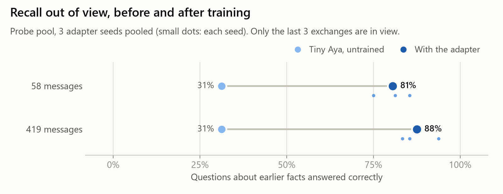
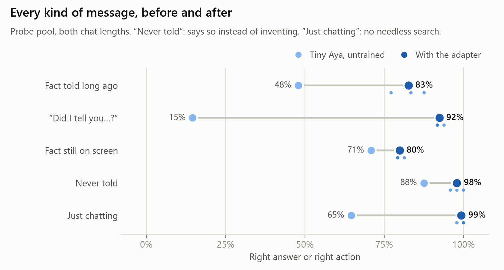
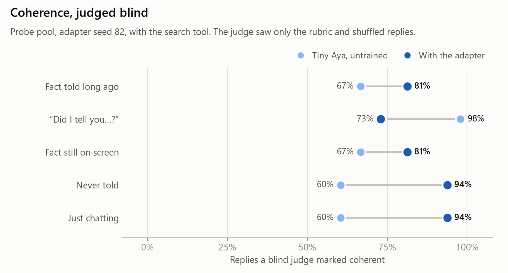
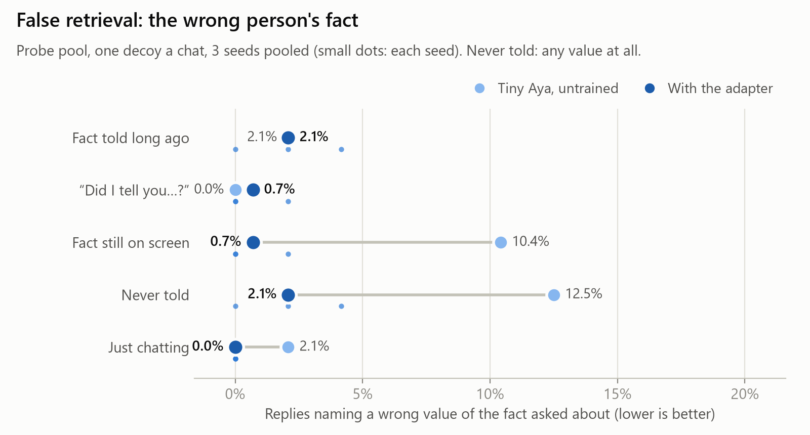
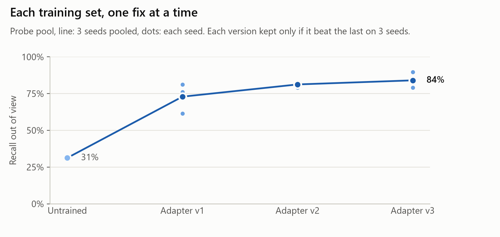
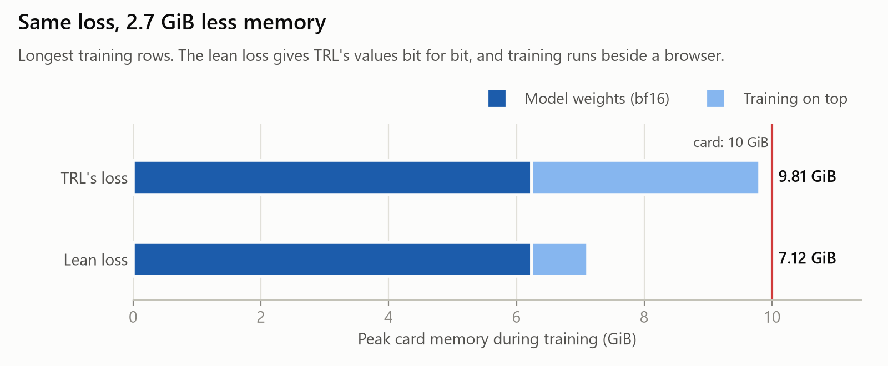

# Teaching a 3B model to remember a long chat it can no longer see

*Kevin Vaillancourt · Lexsi AI Safety and Alignment Hackathon, Track 3 (Agentic Fine-tuning) · November 2026*

> **{{status_line}}**

## Abstract

A small model in a long chat forgets: once a fact scrolls out of its context window, it either says
it was never told or makes something up. We train a LoRA adapter on Tiny Aya Global (3.35B
parameters) to search the earlier conversation when, and only when, the answer is out of view, to
read what comes back, and to answer in the model's own voice. With only the last three exchanges
in view, the adapter answers questions about earlier facts correctly {{tuned_recall_58}}% of the
time in 58-message chats and {{tuned_recall_419}}% in 419-message chats, against
{{base_recall_58}}% and {{base_recall_419}}% for the untrained model ({{gain_58}}% and
{{gain_419}}%). {{coherence_summary}} {{false_retrieval_summary}} {{hard_dev_abstract}} Every training change was
screened against a rule written before its run, and the final test was registered in advance and
then only made harder: a crowded condition with four distracting facts per chat, and a second
test pool written by an independent agent and never read by the authors. We also report two
findings about the toolkits we built on: a defect in AuditKIT's significance test, and a change to
TRL's loss that gives the same results with {{mem_saved}} GiB less memory.

## 1. Introduction

Chat products keep long conversations, but a small model can only attend to a short window. The
usual answers are to send the whole conversation every turn, which costs more with every message,
or to bolt retrieval on with code around the model. We ask whether a 3B model can learn the
retrieval behaviour itself: decide when an answer is out of view, write a search, read the
result, and answer without sounding any different from before.

The Track 3 statement asks for a model that "decides when and what to retrieve, grounds its answers
in the retrieved text and ignores distracting documents". Each phrase maps to a measure here:

| Track statement | Measure |
|---|---|
| decides **when** to retrieve | right decisions: searched exactly when the answer was out of view |
| decides **what** to retrieve | the fact was found by the model's own query |
| **grounds** its answers | recall: the right fact in the reply |
| **ignores distracting documents** | false retrieval: a decoy's fact in the reply, with one and four decoys a chat |

**Contributions.**
1. A training recipe that teaches the habit without changing the voice: the model is trained on
   its own replies wherever they are right, and the tool's real output is always shown.
2. A test that is hard to game: pre-registered, amended only to make it harder, with a sealed pool
   written by an independent agent, a crowded condition, blind coherence judges and a second
   scorer from AuditKIT.
3. An ablation record of every change tried, kept or dropped, each against its own reference.
4. Two toolkit findings (AuditKIT's bootstrap, TRL's loss memory) and a cost comparison against
   closed models.

## 2. Related work

Tool use can be learned from demonstrations of when a call helps (Toolformer, Schick et al., 2023)
and interleaved with reasoning (ReAct, Yao et al., 2023). Adaptive retrieval asks when to retrieve
at all: popular facts are answered from memory, rare ones looked up (Mallen et al., 2023), and
Self-RAG trains a model to decide and to critique its own retrievals (Asai et al., 2024). RAFT
fine-tunes on retrieved sets that include distractor documents, so the model learns to cite the
right one (Zhang et al., 2024); our decoys play the same role inside a conversation. For long
chats, MemGPT manages memory with an agent loop around the model (Packer et al., 2023), and
LongMemEval measures long-term chat memory (Wu et al., 2025); models also use the middle of long
contexts poorly (Liu et al., 2024), which is one reason to keep the window short and search
instead. Training on a model's own outputs that pass a check follows STaR (Zelikman et al., 2022).
Coherence is judged by a model, as in LLM-as-a-judge evaluation (Zheng et al., 2023), but blind to
which model wrote each reply. Adapters are LoRA (Hu et al., 2022).

## 3. Task

A conversation has run for 58 or 419 messages. The model sees the system prompt, the last three
exchanges and the friend's newest message. Everything earlier sits behind one tool,
`search_corpus`, a full-text search over the earlier conversation that returns the top five
passages; the model may call it up to three times a turn. The newest message is one of five kinds:

| Kind | Example | What a good reply does |
|---|---|---|
| Fact told long ago | "drawing a blank on my daughter's tattoo" | searches, then answers ("a koi") |
| "Did I tell you…?" | "did i say anything about my godfather's tattoo" | searches, then confirms with the fact |
| Fact still on screen | "what language does Chidi speak" | answers from view, no search |
| Never told | "did i ever bring up what my mentor grows" | searches, finds nothing, says so |
| Just chatting | "i got stuck talking to Lucia for an hour" | replies, no search |

Every chat also holds **decoys**: the same type of fact about other people ("my classmate is scared
of heights" beside "my tutor is scared of spiders"), so a search can bring back the wrong person's
fact.

**Pools.** Conversations are built from templates in four pools that share no people, relations,
values, subjects or wording: **train**, **probe** (development; never trained on), **held-out**
(sealed) and **independent** (sealed, written by a separate agent; section 5).

## 4. Method

**Training data.** {{training_setup}} For every training conversation the untrained model is run on
the same turn. Where its reply passes the scorer, that reply is the target, so training teaches
the habit of searching and reading without teaching a new voice. Where a search is needed, the row
shows a clean call with the demonstrated query, the tool's real output and then the answer; if the
real search missed the fact, the row says the model does not know, so a demonstration never
contradicts what the tool returned. Where the untrained model's answer fails, a short scripted
answer stands in. The number of decoys varies per row, so the number of passages a search returns
never gives the answer away. Plain chat lines take the untrained model's reply when it is asked to
be brief (the instruction is not part of the row), and a blind judge marks every such target on the
coherence rubric before training; the 8% it rejects are swapped for spares it accepted (R-058,
R-060). This filters the targets by the same rubric the coherence judges use, so the adapter is
trained toward what this kind of judge accepts; the held-out judges are the same kind.

**Training.** LoRA on Tiny Aya Global through AgentTune's distillation trainer (TRL underneath),
with the loss replaced by an equivalent that uses less memory (section 9). Three training seeds per
version. Rows were passed to TRL as chat messages with its defaults, which put the loss on every
token of a row, not only on the turns it teaches (4% of the tokens): the model also learned to
write the friend's lines, the tool's passages and the scripted small talk in view (R-076).

**How changes were made.** One change at a time. A change is screened on one training seed against
its reference on a development probe; if it gains, a rule is written down and then it is trained on
three seeds and confirmed on a second probe, with blind coherence sheets. Every step is a dated
entry in [`RECORDS.md`](../RECORDS.md), and every rule is committed before its runs.

## 5. Evaluation protocol

**Measures.** Recall (correct answers on the two kinds that need a search), right decisions,
correct answers per kind, false retrieval (a reply naming a wrong value of the fact asked about:
a decoy's, or for a question never told, any value), and coherence. Our scorer fails a reply that
names any wrong value; AuditKIT's agent evaluation scores every reply a second time with its own
oracles.

**Coherence.** A fresh judge model receives only a rubric and a shuffled sheet of replies, without
knowing which model wrote which, and marks each 1 or 0: does it respond to the newest message, fit
what was said, read as ordinary language, and avoid contradicting what is in view? The key is
opened only after the marks are in. Fact questions are judged with the tool for both models;
on-screen facts and ordinary chat are judged against the untrained model with no tool at all, so
the adapter is held to the model's own ordinary talk.

**Statistics.** Base and adapter run on identical conversations. Paired comparisons use the exact
sign test on the conversations where they differ; intervals are 95% percentile bootstraps over
conversations, keeping the pairing.

**The final test.** Registered before training (R-016) and amended twice before any run, each time
to make it harder: four conditions, base and three adapters on identical conversations, 300
conversations each.

| Condition | Pool | Decoys a chat | Added by |
|---|---|---|---|
| A | held-out | 1 | R-016 |
| B | held-out | 4 | R-038 |
| C | independent | 1 | R-039 |
| D | independent | 4 | R-039 |

Recall must be at least 20 points above the untrained model at each chat length with a sign test
below p = 0.01, counting all right answers and again counting only retrieved ones (R-041), false retrieval no higher than the untrained model's, and coherence at or above
it, in every condition. The held-out pool was written by Claude, the author's AI assistant, in the same
session as the training pool; the independent pool was written by a fresh agent that saw only a brief, an
avoid-list and a checker, and nobody on the project has read it (R-039).

**Development tests beyond the probe.** Every probe used in development shares the training pool's
author and style, so three harder checks were added before the final test, none of them deciding a
version: the crowded condition on the probe; `hard_dev`, a twin of the independent pool written by
a second fresh agent from the same brief, readable and used for development only (R-066); and
stress transforms applied to any pool, taken from the failure categories of the author's earlier
chat engine (its categories only, none of its text): the user's typing style, facts corrected
later, and 1,000-message chats (R-067). Writing the twin from the independent pool's brief, and
training on material written to a similar brief, makes the sealed independent pool less
independent of development than it was; it still shares no content with any other pool.

## 6. Results

{{results_scope}}

{{recall_intervals}}

### Retrieved, not guessed

A right answer can come from reading the fact or from guessing among plausible values. Each answer is
counted by where it came from: **retrieved** if the exchange holding the fact was among the results
of a search the model itself made, and a **guess** otherwise.

{{sources_text}}

### Every kind of message

| Kind | Untrained | Adapter | Above untrained |
|---|---|---|---|
{{kind_table}}

Right decisions, searching exactly when the answer is out of view: {{decisions_base}} of
{{decisions_n}} untrained, {{decisions_tuned}} of {{decisions_n}} with the adapter. {{kinds_summary}}

### Coherence, judged blind

{{coherence_text}}

### False retrieval: the wrong person's fact

{{false_retrieval_text}}

### Harder development checks: where it still fails

{{crowded_text}}

{{hard_dev_text}} This is the largest gap found, and the sealed independent pool, written to the
same brief, is likely to show it. Fixes 14 to 17b are aimed at it (section 7 and section 11's
failure modes).

### A second scorer: AuditKIT

Each turn becomes an AuditKIT episode (the friend's message, the search calls, the final reply),
and AuditKIT's own oracles decide each case; for the fact questions this is its `AnswerAssertion`,
which matches whole words and is stricter than our scorer. {{auditkit_text}}

## 7. Ablations: every change tried

Each row is one training seed on the development screen, against its own reference. Recall is out
of 96, on-screen answers out of 48, right decisions out of 240; the paired counts and sign test are
over all 240 conversations.

{{ablation_table}}

What the path shows:

1. **The first adapter memorised.** It scored {{first_adapter}} on training-style conversations and then
   failed on the probe pool's unseen content. In training, the number of passages a search returned
   gave the answer away, so it learned to search, not to read. Varying the decoys fixed it (**v1**).
2. **A false denial from one training sentence.** Many found-fact answers opened with the same word
   as a training sentence meaning "I don't know", and one seed slid into it. Changing that sentence
   fixed it (**v2**).
3. **Facts still on screen.** Rows where the untrained model had failed were added, answered through
   a hint that is removed from the row (**v3**).
4. **Coherence on "Did I tell you…?" fell below the untrained model.** The adapter answered a
   question with "That's great news!", or "Esme, who is my tutor, speaks fluent Turkish". Both came
   from training answers: some of the untrained model's own answers on this kind opened with a
   reaction to news, and most scripted answers left the relation out, so the model never saw the
   friend's "my tutor" turned into "your tutor". Plain answers that name the relation from the
   friend's side closed the gap (**v4**).
5. {{dropped_fixes}}
6. **Training harder raised recall and cost coherence on plain chat.** A higher rank, LoRA on the
   MLP layers and a higher learning rate each gained recall on the screen, and all three together
   came close to every recall question. Its confirmation failed on the blind check of plain chat
   lines: told "my tutor has been acting strange lately", it searched and stated a stored fact about
   the tutor (R-055). The training set had six chat lines against 25 fact templates, so a model
   trained harder treated any line about a named person as a lookup. Searching in the friend's own
   words (fix 7) showed the same pull from the other side: recall rose and never-told questions
   were answered with other people's facts (R-050, R-054).
7. **The plain-chat habits came from the targets.** Adding 48 chat lines (fix 9) fixed the lookups,
   and its recall was 34% above v4's, but at one seed of three the judge still marked six chat
   replies incoherent, among them "Lucia is a great name." Those were the untrained model's own
   habits, copied from its replies in the training set. A blind judge vetting those targets first
   (fix 10) cut that seed's misses from six to three, one short of the untrained model; asking the
   untrained model for brief replies before vetting them (fix 11) passed on every seed (**v5**,
   R-057 to R-061).

## 8. Cost

{{roi_tokens}} Sending the whole chat costs more with every message; the adapter's cost per turn
stays flat.

{{roi_text}}

## 9. Toolkit findings

**AuditKIT's paired bootstrap does not centre its resamples.** A gain on 100 of 100 pairs comes out
as p = 1.0, and on this project's data it reported p = 0.52 for {{auditkit_bug_example}}. It is
shared by AuditKIT's model comparison, run comparison and experiment significance. We use the exact
sign test and a correctly centred bootstrap instead; the defect, a reproduction and a one-line fix
are in [`docs/auditkit_bootstrap_defect.md`](auditkit_bootstrap_defect.md).

**TRL's chunked loss copies the output layer for every chunk.** Training first peaked at
{{mem_before}} GiB on a 10 GiB card, so any other program on the card pushed it into shared memory
at several times the step time. The loss computes `h.float() @ w.float().t()`; under bf16 autocast
both float32 copies of the 262,144-word output layer are cast straight back to bf16, so they change
nothing but memory. A replacement that takes the bf16 product directly gives TRL's loss, scores and
gradients bit for bit (tested), and training peaks at {{mem_after}} GiB at about {{step_seconds}} s
a step. Retrained with it, v3 differed from its original on {{lean_retrain_diff}} conversations, inside
run-to-run variation (R-032).

**CuratorKIT's grounding gate finds faulty training answers our own checks missed.** The gate asks
a judge whether each answer is supported by the source it came from. We ran it over the 350 training
answers that follow a search, with Claude judges plugged into CuratorKIT's own backend class: the
gate's prompts were recorded, answered by three judges in turn, and replayed, so CuratorKIT's
prompt, parsing and threshold decide every verdict, and the saved verdicts rerun to the same result.
It rejected 22 answers (21 of them by all three judges): 8 that pin a relation on the wrong person,
and 14 our pattern check could not see, such as "Greta's brother adopted a dog named Pepper." for
"the dog Greta adopted", claims the passage does not make, and off-topic talk (R-096). It is an
audit of the training targets, not an independent test of the model: its judges are the same model
family as our coherence judges.

The same gate then served as an acceptance test for new training answers before any training run
(R-098): one blind, shuffled sheet held 15 scripted replacements, the 22 rejected answers as hidden
controls and 20 answers it had passed. Three fresh judges passed all 15 replacements, rejected all
22 controls again and rejected none of the 20.

## 10. Threats to validity

- **Synthetic conversations.** All chats are generated from templates; real chats are messier. The
  independent pool was written to be harder (run-on messages, texting style, values that are easy to
  confuse), but it is still templated. Messy input is measured on the frozen model, paired against
  the same items typed cleanly: lower-case texting, facts corrected later, an earlier question still
  in view, and a phone-typing form (dropped apostrophes, "u" for "you", a slipped letter) that no
  training row uses. Training on messy rows was registered to happen only if one of these costs at
  least 8 of 192 recall answers (R-099). Typing style cost v5 at most two answers of 96; an earlier
  question in view cost v6 none on the probe and 7 of 96 on `hard_dev`.
  An outside check on a public chat set built by others, LoCoMo (Maharana et al., 2024), is
  registered for the frozen model, with base on the same questions; it decides nothing (R-100).
  The measurement found one large weakness: when the user corrects a fact later in the chat, v6
  searches, finds both versions and answers with the old one (5 of 96 right on the probe, against
  base's 19; R-102). The messy-input plan registered in R-099 would have judged a fix for this on
  phone typing, which a fix for corrections is not built to change, so the researcher amended that
  one test before any fix existed: a fix is now judged on corrections worded in ways it never
  trained on, written by an agent that saw no project file, with every other check unchanged.
  On November 6 the researcher also changed how fixes are built: a fix that fails a check is kept as
  a stepping stone and trained further on what it broke, instead of starting again from v6, and only
  the final copy is judged by the full set of checks, which do not change (R-103). Before this, each
  fix started from v6, so one that fixed something and broke something else lost both: the
  who-is-who fix removed the slip at both seeds tried but cost hard-question recall, and was
  discarded with its gain (R-101).
  The first stone, 6.1, trained on corrections worded in training's own ways, gives the corrected
  value on all 192 of the held-out probe corrections and 159 of 192 on `hard_dev`, against v6's 1
  and 5 and base's 9 and 8 a seed; phone typing held. It broke three smaller things, which became
  the next stone's targets: `hard_dev` recall fell below v6's at one seed (69 against 83, mostly
  replies that found the fact and left out the detail asked for), the who-is-who slip rose to 4 at
  the other, and one screen recall answer was lost (R-104).
  The second stone, 6.11, keeps 6.1's rows, swaps in the who-is-who fix's 41 answers, and trains one
  more gentle epoch from 6.1's saved weights, beside a control that trains the same epoch without the
  swap; it is judged by the full set of checks, and only fresh seeds count as evidence (R-105).
  6.11 removed the who-is-who slip at every seed, kept the corrections gain (190 of 192 on the probe,
  167 of 192 on `hard_dev`) and lifted `hard_dev` recall above v6's, but answered 190 of 192 probe
  recall questions where v6 answered all 192, so it misses one check by two answers; the control,
  without the swap, kept the slips, so the swap is what removed them (R-106).
  The probe check asks for a perfect score, since v6 answered all 192; copies no worse than v6 met
  that at 9 of 12 seeds tried. The next step, 6.111, trains one more gentle epoch on 6.11's own rows
  with nothing added, because rows aimed at the two missed questions would be built from the
  development questions themselves; if it fails, a single from-scratch run of 6.11's rows comes next,
  chosen before the result. Each try at the development seeds is counted and reported (R-107).
  6.111 kept the slips at or near zero but lost recall on both sets (189 of 192 on the probe, 153 on
  `hard_dev` against v6's 157), so the extra epoch did not help; 6.2, the from-scratch run fixed in
  advance, is the next try (R-108).
  6.2 passed every check at the development seeds: every probe recall question answered, no who-is-who
  slip at either seed, `hard_dev` recall 166 against v6's 157, held-out corrections 192 and 169 of 192
  where v6 answered 1 and 5, and the coherence sheets under the deciding judge; one of the two other
  judges would have failed one sheet by two lines. It is the eighth copy tried at those seeds; fresh
  seeds decide (R-109).
  Every passage in 6.2's training set is one short fact line, while the development set states facts
  in long run-on lines, and most of 6.2's remaining misses find the right line and leave out the asked
  detail. The next stone, 6.21, adds 100 training-pool rows whose found line says more than the asked
  detail (two facts about one person, or the fact among other talk) and trains one gentle epoch on
  6.2, beside a control; the shapes of the development questions it misses are kept out (R-110).
  At the three fresh seeds 6.2 passed every counted check (every probe recall question, 244 of 288
  on `hard_dev` against v6's 238, at most one slip a seed, held-out corrections 82 to 96 of 96), but at
  one seed it failed a judged coherence check, with 4 fewer sensible replies to plain statements than
  base: the friend said something like "Hana forgot my birthday again" and 6.2 searched and answered
  with an unrelated stored fact. All three judges agreed. 6.2 is not shipped; its successor 6.21 goes to the fresh seeds
  (R-112).
  6.21 did not get that far: at the development seeds its hard-question recall fell to 155, below
  v6's 157, and the misses it was built to remove (the right line found, the asked detail left out)
  rose from 18 to 29. Neither stone replaces v6 (R-113).
  A last try, 6.3, is trained from scratch on 6.2's rows plus 109 rows from an earlier fix built
  for plain statements (57 chat lines that name a fact type, answered without a search, and 52
  questions asked as statements, answered from one). It is confirmed on three training seeds never
  used before; if it fails any line, v6 ships (R-114).
  A control, one more epoch on 6.2's own rows, lost 6 hard questions by itself, so about half of
  6.21's drop came from the extra epoch and half from its added rows (R-115).
  6.3 failed at the development seeds: at one seed it answered 7 questions in the form "Ayaan, who
  is my teammate, speaks fluent Korean.", copying a stored line's wording, and it still answered
  "Esme forgot my birthday again" with a search 3 times (R-116).
  The next try, 6.31, again from scratch, gives its question-as-statement rows one fixed answer
  form ("Your sister Tomas keeps geckos.") and adds 24 chats where someone else forgets or loses
  something and the reply needs no search (R-117).
  6.31 answered fewer questions whose answer is still in the chat; it offered sympathy instead.
  Two copies add 72 such chats answered plainly: 6.311, one short epoch on top of 6.31 (Kevin's
  call), and 6.32, from scratch. Which goes on was fixed before either was read (R-118).
  6.31 itself fell one question short of v6 on the probe's recall (191 against 192): the missed
  question got sympathy instead of a search (R-119).
  6.311 answered every probe in-view question, but its recall of searched facts on the harder set
  fell from 163 to 122: it found the line and then gave only the kind of fact, not the detail (R-120).
  6.32, the same rows from scratch, lost the detail too (133): the short scripted answers, not the
  training on top, were the cost (R-121).
  The next tries only remove rows from 6.31. 6.33 drops the 15 small-talk rows that pair "forgot"
  or "lost" with no search, the likely cause of 6.31's one miss (R-122).
  It fixed that question and missed another by one, a search that split "stepsister" into
  "sister steps out" (R-123).
  6.34, with the in-view rows also removed, began searching on "Esme forgot my birthday again"
  and split "stepsister" on a second question (R-125).
  6.36, removing only 6 of those small-talk rows, brought back the tattoo miss and searched on
  most "forgot my birthday" lines (R-126).
  The rows split into frames: the "lost wallet", "forgot umbrella" and "lost track of time" ones
  go with the tattoo miss, the "forgetting to text" and "forgot lunch" ones with the birthday
  lines. 6.37 drops only the first three (R-127).
  6.37 passed every counted and judged line at seeds 82 and 83, all three judges agreeing, and is
  being confirmed at fresh seeds 94 to 96 (R-128).
  It also kept answering with corrected facts and with phone-style typing (R-129).
  At fresh seeds 94 to 96 it matched v6's recall on the probe (287 each) and beat it on the
  harder set (247 against 237), and every coherence sheet was at or above base under all three
  judges (R-130).
  It kept the corrected facts and the phone-typing answers at those seeds too, so 6.37 replaced
  v6 as the copy that ships (R-131).
- **One author for train and held-out.** The held-out pool shares no content with training but was
  written by the same assistant; condition C and D's independent pool exists for this reason.
- **Development numbers.** The probe pool guided every change, so its numbers flatter the adapter;
  only the sealed pools decide.
- **The never-told scorer** passes any reply that names none of the listed values, so an invented
  value outside the list can pass; false retrieval undercounts for that kind.
- **The coherence judge** sees only the turns in view, so it cannot tell a false "you never told me"
  from a true one; recall is always read beside it. In development, "never told" replies were not
  on a coherence sheet; the final sheets cover every kind.
- **Judges disagree by a few lines.** The untrained model's replies are the same on every sheet of a
  kind, so its score shows how much judges agree. On plain-chat and in-view lines they agreed within
  one line in 48; on "fact told long ago" lines, three judges gave the same 48 replies 34, 17 and
  30, because one marked down any reply that opens with a name (R-057). Claims on that kind rest on
  the pooled, paired comparison, where the adapter's lead (130 against 81) is larger than that
  spread. Late in development each sheet had three judges, one named in advance to decide; on the
  same 96 check-set lines they differed by up to five (R-089), so a one-line verdict is close to
  that spread. To compare candidates, every model's replies went on one blind sheet, so the same
  judges marked them all (R-090).
- **Many candidates, one set of development data.** Every change in section 7, and every scaled or
  mixed adapter tried (R-090), was chosen on the probe, `hard_dev` and, from R-085, the blind chat
  check set; section 7's table lists each one scored, failed ones included. Those numbers flatter
  whatever was chosen; only the sealed pools, run once, decide.
- **Development pools and the sealed one share a brief.** `hard_dev` and the wide training pool
  were written to briefs like the independent pool's, so the final test's independent condition is
  less independent of development than when it was registered (R-066, R-069). One writer of the
  wide pool, since discarded, saw fragments of sealed wording through a checker that reported
  only counts; that pool was never used (R-070).
- **Training is not bit-reproducible on this card.** With the same rows and seed, TRL's own first
  gradient norm varied from run to run (R-029), so every claim pools three seeds.
- **Seeds differ more than a screen can show.** Trained six times with the same rows, fix 17b's
  `hard_dev` recall ran from 65 to 83 of 96 and its plain chat fell below the untrained model's at
  two seeds of six (R-091). A single-seed screen can only rule a change out when the change is
  large; every candidate that went further was checked at two or three seeds, and the rule that
  decides needs three.
## 11. Errors and corrections

Every error of method below was found during the work and is recorded where it happened; none is
hidden by a later result.

- **The first adapter's score was memorised.** It answered 119 of 120 on conversations like its
  training set and failed on a fresh probe, because in training the number of passages a search
  returned gave the answer away. Decoy counts now vary per row so the count carries no signal
  (R-018, R-020).
- **A plateau called too early.** After two fixes failed, we called v5 final on the strength of
  the probe alone (R-064). Challenged, we tested harder conditions: the crowded condition held,
  but the `hard_dev` twin showed recall of 60% against 97% on the probe (R-065, R-068). The probe
  shared the training pool's author and style and hid the gap.
- **A screen that counted the wrong thing.** The screen scored plain chat by whether the model
  searched, not whether its reply made sense, so a stronger adapter passed the screen and failed
  the blind judge (R-055). Every confirmation since judges plain chat on every seed.
- **One judge a sheet.** Three judges gave the same 48 untrained replies 34, 17 and 30 on one kind
  (R-057). Conclusions on that kind rest on pooled, paired comparisons, and section 10 says so.
- **A checker that pushed a writer to the sealed data.** The checker for an independent writer
  reported only how many of its lines clashed with other pools, so the writer wrote its own
  script, which printed fragments of sealed wording. That pool, meant for training, was discarded
  unused, and the checker now names only the writer's own lines (R-070).
- **A toolkit defect.** AuditKIT's paired bootstrap does not centre its resamples, so it reports
  large gains as not significant; we use an exact sign test and a centred bootstrap (section 9,
  R-031).
- **A training default not checked.** Every adapter through v5 was trained with TRL's default of a
  loss on every token of a row, found only when replies turned out to be copied from the scripted
  history (R-076; see the failure modes below).
- **A build that wrote before it checked.** The training-set build wrote its file before checking
  that no row exceeded the 1,024 tokens training keeps, so three screens (fixes 14, 14b and 14c)
  trained on sets with three to five rows whose answers were cut. The build now skips such rows
  and checks before writing; those screens are reported as screens of the sets they used (R-073).

**Failure modes found in the model.** Each was found by reading replies, not totals, and each
came from something in the training data.

- **A name became a search instruction.** Trained harder, the adapter treated any line about a
  named person as a lookup: told "my tutor has been acting strange lately", it searched and
  stated a stored fact about the tutor (R-055). The training set had six plain-chat lines against
  25 fact templates. Forty-eight more chat lines fixed the lookups (fix 9). The same bug came back
  with the wide pool: its names appeared only in rows that need a search, so "i should really
  call my mentor" was searched as "mentor phone number" (R-071; fix 14b adds the wide pool's
  people to plain-chat rows).
- **The untrained model's habits, copied.** Plain-chat targets are the untrained model's own
  replies, so the adapter learned its weak ones: "Lucia is a great name.", a book character for a
  friend's name, an earlier topic pulled into a reply (R-057, R-059). Vetting the targets with a
  blind judge, then asking for brief replies before vetting, removed them (fixes 10 and 11, v5).
- **Unfamiliar facts forced into familiar ones.** On text written by someone else, the adapter
  searched for an unfamiliar kind of fact with the query phrase of the nearest training fact type:
  "where my babysitter came of age" became "babysitter born birthday month". The right passage
  came back and the reply denied it or answered the question it had searched for (R-068).
  Training on 47 new fact types lifted recall there from 58 to 76 of 96 at one seed (fix 14,
  R-071); not yet confirmed.
- **Another person's fact, stated as the answer.** With the new fact types, a question about a
  fact never told brought back someone else's fact of that type, and the reply gave it as the
  answer: asked what "my goddaughter" studied, it replied "Isolde finished a course in
  philosophy", from a line about Isolde, the babysitter (R-071). All 16 such misses at one seed
  repeat the other person's value. When a search returned passages, v5 declined correctly 22
  times of 23 and the wide-trained adapter 17 of 33: it finds more and checks less whose fact it
  found (R-073). Showing it 100 more same-type facts about other people (fix 15) brought
  `never_told` back to 136 of 144 over three seeds with recall kept (R-075).
- **Scripted small talk, copied word for word.** Some plain-chat replies are lines from the
  scripted small talk that fills each training conversation: "Hm, good question, i'd say it
  depends", "Hope my barber settles down soon" (R-061, R-075). Training put its loss on every token
  of a row, and the five most common scripted replies each appear more than 100 times in the
  assistant's place, against at most 16 for any reply a row teaches (R-076). With the loss on the
  taught turns only (fix 16a), no `hard_dev` reply at seed 82 repeats a scripted line, against one
  for v5 and up to eight for fix 15, and `hard_dev` recall rose from 58 to 70 of 96 with no new data
  (R-077).
- **Faults in the targets, copied more closely.** With the loss on the targets alone, the adapter
  copies its plain-chat targets more faithfully, faults included, and fix 16a fell below the
  untrained model on plain chat (R-077). Some targets that the first vetting had accepted read a
  complaint as good news, call the friend by another person's name, or wish someone a good time
  at an event the friend never mentioned: "Good luck with your date with Marc." for "Ivan asked me
  to be their plus one". Two judges re-vetted the targets on a stricter rubric that names these
  faults and replaced 15 of 150 (R-078). Trained on them, fix 17b matched or beat the untrained
  model on both plain-chat sheets at seed 82, with `hard_dev` recall 72 of 96 (R-080). Over three
  seeds it raised `hard_dev` recall from v5's 172 of 288 to 228 and passed every count, but at one
  seed it scored one plain-chat line below the untrained model, so by the rule set in advance it
  does not replace v5 (R-082).
- **A chat line that names a fact type, read as a question.** Told "Esme forgot my birthday
  again", fix 17b replied "I don't have that from you. What is it?" at two seeds of three. No
  plain-chat line in training mentions a birthday or any other fact type, so a fact word on its own
  reads as a question about it (R-082). At a sixth seed 17b searched on six chat lines that name a
  person and answered with an unrelated fact: "i should really call my classmate" got "Hana is your
  classmate and is terrified of spiders." (R-091). On 48 fresh chat lines of this kind, written blind by
  another author and never trained on, v5 kept 36 coherent against the untrained model's 44; it
  echoes the friend's "my" ("Hope my godfather gets some rest soon") and repeats one stock reply.
  Fix 17b kept 44 against 45. Adding 57 vetted chat lines that name a fact type (fix 18a) brought
  this to 48 of 48, and 57 lines that name none (fix 18c, a control) to 47, but both cost recall
  on questions asked indirectly: `hard_dev` 56 and 66 of 96 against 17b's 72. Fix 18a found the
  fact as often as 17b, then restated the friend's situation instead of answering ("Your coach
  Rhys got a job interview.") (R-085). Pairing each of those lines with a question about the same
  topic asked as a statement, answered from a search (fix 19a), brought `hard_dev` recall back to 74
  at each of two seeds, above 17b, and kept plain chat above the untrained model at one seed; at
  the other it answered five unrelated complaints with one stock line, "That sounds like a lot of
  work ...", and fell one line short on the check set (R-089). Open.
- **A relation pinned on the wrong person.** v6's fact answers are right but sometimes say whose
  relation it is wrongly: "Hana's barber is scared of clowns." for "what is my barber scared of",
  where the barber is Hana. A pattern check counts 1 to 4 of 96 at five training seeds and 14 at a
  sixth; the untrained model makes it twice. The source is the training answers that are the
  untrained model's own replies: 27 of 350 have this shape, and CuratorKIT's gate rejects 22 for
  this and other faults (R-094, R-096). Rewriting the 27 removed it at every seed tried, including
  the bad one (2, 1 and 0 of 96), but cost one judged line on facts in view (R-095). Dropping the
  15 answers the gate rejected kept the slip down (1 and 1 of 96) and facts in view up at one seed,
  but fell one recall answer short of v6 over two seeds and stopped (R-098). With those 15 answers
  scripted instead, accepted by the gate first, the slip was 0 of 96 at both seeds, but `hard_dev`
  recall fell below v6's (149 against 157 over two seeds), so it stopped too. The registered plan
  allowed two tries; v6 shipped with this failure (R-101). 6.37, which replaced v6, made it once
  in 480 probe answers over five seeds and never on `hard_dev`; v6 made it 16 times in 288 probe
  answers at the fresh seeds 94 to 96 (R-131).
- **A search built from the wrong message.** In the demo chat, "what did i fix under the sink"
  was searched as "brother new job", the query for a question two messages earlier, and declined
  (R-076). No training row or test item had an earlier question in view (R-081). A stress test
  that puts one there, declined, cost v5 two to four recall answers of 96 and the untrained model
  most of its plain chat (31 to 11 of 48 on the probe). Fix 17b kept its recall but turned away
  facts still on screen after an earlier decline ("You can ask your godfather what he grows"), 43
  to 37 of 48; v5 did not (R-084). Open.
- **A found fact denied.** Shorter in-view answers (fix 12) and more indirect in-view questions
  (fix 13) each made the model trust the turns in view more and a search result less: searches
  found the fact and the reply said "I don't have that from you" (R-063, R-064). Both dropped.
- **Forgetting read as wordplay.** "drawing a blank on my tutor's tattoo", with the tattoo still on
  screen, is read as a joke, a drawing request or disappointment, by the untrained model and every
  adapter; it is most of v5's remaining misses on facts in view (R-063). Open.
- **"It sounds like" on facts in view.** On the harder set, 32 of 6.37's 40 misses on facts in
  view, over five seeds, open "It sounds like" and talk about the feeling instead of the fact.
  Removing the 22 training answers that open that way (6.34) removed the opener but not the
  misses: correct answers fell from 78 to 69 over two seeds, the misses moving to searches and to
  denials of the fact on screen. No version 7 was trained (R-132). Open.
- **One sentence, one false denial.** Many found-fact answers opened with the same word as a
  training sentence meaning "I don't know", and one seed slid from one into the other (v2).

## 12. Limitations

What this work does not cover, whatever its numbers:

- **One model, one size.** Only Tiny Aya Global (3.35B) was trained. Whether the recipe carries to
  Aya Expanse 8B or 32B, or to other families, is untested.
- **English only.** Tiny Aya is multilingual, and the friend's messages here are all English.
- **Facts never change.** Each fact is told once and stays true. Real friends correct themselves
  ("actually they moved again"), and the model is never asked to prefer the newer of two facts.
- **One tool, read only.** The model searches but never writes: it cannot save a note, update a
  fact or forget one, which a real memory needs.
- **A fixed window.** The view is always the last three exchanges, and conversations are 58 or 419
  messages. Other window sizes and much longer histories are untested.
- **No hostile text.** Retrieved passages are the friend's own words. Instructions hidden inside
  retrieved text, a risk for any model that reads search results, are out of scope here.
- **Greedy decoding only.** Every reply is greedy; behaviour under sampling is not measured.
- **Judged by models, not people.** Coherence is marked by a language model with a fixed rubric;
  no human panel checked the marks.
- **One machine.** All training and timing ran on one consumer card; costs elsewhere are estimates
  from measured speed and published prices.

## 13. Future work

- **Facts that change.** Train and test conversations where a fact is told, then corrected, and
  score whether the reply uses the newer one.
- **Injection in retrieved text.** Train the model to treat instructions inside search results as
  content, not commands, and test it with hidden instructions in the friend's earlier messages.
  This was the second behaviour in the original plan.
- **Writing memory.** Add a tool that saves a note, so the model decides what is worth keeping, and
  measure recall when only the notes, not the full history, are searchable.
- **Reinforcement on verified outcomes.** The decision to search and the answer are both checkable
  by code, so they suit reward-based training (for example GRPO through AgentTune) on top of the
  supervised adapter.
- **Other languages and larger models.** Repeat the recipe in the languages Tiny Aya supports, and
  on Aya Expanse 8B, with the same sealed-test protocol.
- **Real conversations.** Test on consented real chat logs, and add a human panel beside the model
  judge.
- **Upstream fixes.** Offer the memory-lean loss to TRL and the bootstrap fix to AuditKIT.

## 14. Reproduce

Everything runs on one 10 GB card. The repository holds the pinned model revision, the data
builder, training and evaluation scripts, every results file with its provenance (command, commit,
package versions), every coherence sheet with its key and the judge's marks, and the scripts that
make every number and figure here: `python scripts/make_figures.py` and
`python scripts/make_article.py`. No number in this article is typed by hand.

## Author contributions

Kevin Vaillancourt directed this work, carried out with an AI assistant, Claude (Anthropic), as an
executive-function accommodation. Test pools meant to be independent were written by fresh AI
agents that saw only a brief, and coherence was marked by fresh AI judges that saw only a rubric
and a sheet.

## References

- Asai, A., et al. (2024). Self-RAG: Learning to retrieve, generate, and critique through self-reflection. *ICLR*.
- Hu, E. J., et al. (2022). LoRA: Low-rank adaptation of large language models. *ICLR*.
- Liu, N. F., et al. (2024). Lost in the middle: How language models use long contexts. *TACL*.
- Mallen, A., et al. (2023). When not to trust language models: Investigating effectiveness of parametric and non-parametric memories. *ACL*.
- Packer, C., et al. (2023). MemGPT: Towards LLMs as operating systems. *arXiv:2310.08560*.
- Schick, T., et al. (2023). Toolformer: Language models can teach themselves to use tools. *NeurIPS*.
- Wu, D., et al. (2025). LongMemEval: Benchmarking chat assistants on long-term interactive memory. *ICLR*.
- Yao, S., et al. (2023). ReAct: Synergizing reasoning and acting in language models. *ICLR*.
- Zelikman, E., et al. (2022). STaR: Bootstrapping reasoning with reasoning. *NeurIPS*.
- Zhang, T., et al. (2024). RAFT: Adapting language model to domain specific RAG. *COLM*.
- Zheng, L., et al. (2023). Judging LLM-as-a-judge with MT-Bench and Chatbot Arena. *NeurIPS*.

*Prior work: Latent Lab Explorer, the author's local chat engine, enforces these behaviours with
code around a Llama model; this project trains them into a model, and uses none of its code or test
sets. Built with AgentTune and AuditKIT from Lexsi Labs. Tiny Aya is CC-BY-NC-4.0, and the adapter
carries that licence.*
