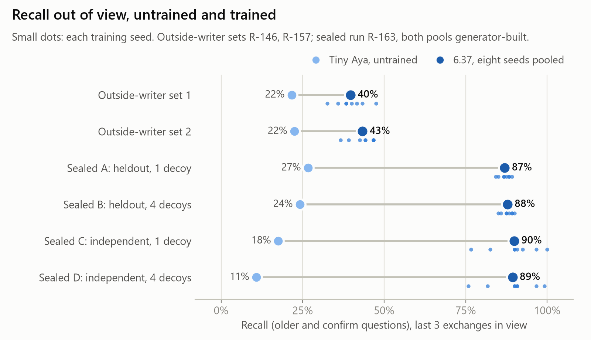
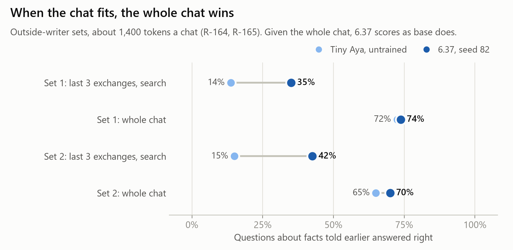

# Teaching a 3B model to search a long chat it can no longer see

*Kevin Vaillancourt · Lexsi AI Safety and Alignment Hackathon, Track 3 (Agentic Fine-tuning) · November 2026*

Trained with Lexsi's AgentTune, a LoRA adapter (6.37) lets Tiny Aya Global (3.35B), shown only the last three
exchanges of a chat, search the rest when the answer is out of view. On the sealed test (300 unseen generated chats
in each of four conditions, run once), the shipped seed recalls 91 to 107 of 120 facts; the untrained model with
the same tool recalls 13 to 32. On chats from outside writers (written by Claude Opus agents, about 1,400 tokens),
the untrained model shown the whole chat does best (71 and 65 of 120), and code that searches every turn recalls as
well as 6.37 (42 and 47 against 39 and 53) and runs faster. There, training's measured gain is when to search:
6.37 searches for facts out of view, which base rarely does, and leaves answers already in view alone (35 and 37 of
40 right), where code searches every turn (13 and 16).

This is a short version of the full write-up,
[docs/ARTICLE.md](https://github.com/Vee-industries/aya_retrieval/blob/main/docs/ARTICLE.md). Code, every results
file and `RECORDS.md`, the dated record of every decision and run, are in
[github.com/Vee-industries/aya_retrieval](https://github.com/Vee-industries/aya_retrieval); record ids (R-164 and so
on) point into `RECORDS.md`. Adapter:
[KevinVaillancourt/aya-retrieval-6.37](https://huggingface.co/KevinVaillancourt/aya-retrieval-6.37). Collections:
[models](https://huggingface.co/collections/KevinVaillancourt/aya-retrieval-models-6af35d3c521e8481db061df5) and
[datasets](https://huggingface.co/collections/KevinVaillancourt/aya-retrieval-datasets) (training chats and every
evaluation log).

**Access.** The adapter and both datasets are public and un-gated (checked 2026-11-12, no login). The base model
CohereLabs/tiny-aya-global is gated: accept its licence on Hugging Face first.

## Terms

- **Base**: the untrained Tiny Aya Global.
- **Tool**: `search_corpus`, a full-text search over the messages older than the last three exchanges.
- **Code**: code that searches on every turn with the newest message as the query, then hands base the passages.
  Nothing is trained.
- **Recall**: right answers on `older` questions (about a fact now out of view) and `confirm` questions ("...,
  right?" about such a fact).
- **In view** (`in_view`): the answer is still in the last three exchanges. **Never told** (`never_told`): the fact
  was never given, so the right reply declines. **Statement** (`statement`): plain chat, where the right move is not
  to search.
- **Seed 82**: 6.37 as shipped, one of eight training seeds of the same recipe.
- **Sealed test**: the registered final test, run once on 9 November, with the model, scorer and judge frozen by
  digest beforehand.
- **Outside-writer sets**: two sets of 40 chats by fresh Claude Opus agents who never saw the generator. Set 1
  became a development set when a later candidate, 7, was designed from its failures; set 2 was read by no decision
  that changed 6.37.
- **Judge 1**: three judges mark each reply; judge 1's mark is the score, and the other two are reported.
- **Clean call**: a reply that parses whole as one `search_corpus` call, with nothing before or after it, counted
  over the replies that searched. It is a format measure: an unclean call still ran its search.

## Results at a glance

Outside-writer chats, two sets (set 1 / set 2), one run each:

| Measure | Base, tool | Code | Base, whole chat | 6.37, tool |
|---|---|---|---|---|
| Recall, of 120 | 26 / 27 | 42 / 47 | 71 / 65 (best) | 39 / 53 |
| Answer already in view, of 40 | 36 / 34 | 13 / 16 | 35 / 32 | 35 / 37 |
| Never told, of 40 | 34 / 32 | 31 / 24 | 31 / 28 | 37 / 36 |
| Plain statement left unsearched, of 40 | 38 / 39 | 0 / 0 (searches every turn) | 40 / 40 (no tool) | 37 / 35 |

Generated chats:

| Measure | Base, tool | Code | Base, whole chat | 6.37, tool |
|---|---|---|---|---|
| Sealed test recall, of 120, four conditions | 13 to 32 | not in the sealed run | not in the sealed run | 91 to 107 |
| Recall, of 60, sealed pools after the run (R-168) | 5 to 17 | 14 to 32 | 21 to 33 (58 messages only; 419 messages does not fit 10 GB) | 44 to 55 (46 to 55 at 58 messages) |
| Right search decisions, of 300 (sealed) | 180, 193 | not run | not run | 298, 296 |
| Clean first calls (sealed; of the turns that searched; format only, unclean calls still ran) | 52 of 136, 49 of 107 | scripted | no tool | 180 of 180, 184 of 184 |

LongMemEval-S (500 questions; history about 115,000 tokens, so no whole-chat arm fits; judged by three Claude
Sonnet judges with LongMemEval's prompts, not the official GPT-4o judge):

| Measure | Base, tool | Code | 6.37, tool |
|---|---|---|---|
| Judged right, of 248 judged | 34 | 40 | 53 (p = 0.014 against base, 0.12 against code) |
| Of those, answerable, of 233 | 32 | 40 | 40 (p = 0.29 against base) |
| Declines on answerable, of all 470 | 22 | 1 | 233 |
| Declines on unanswerable, of all 30 | 2 | 0 | 21 |
| Gold answer in reply, of 411 (mechanical) | 51 | 63 | 51 |
| Clean first calls (of questions that searched) | 146 of 328 | scripted | 441 of 441 |
| Seconds a question | 3.47 | 3.09 | 3.81 |

## Which to use when

1. If the whole chat fits in the context, show it whole: base with the whole chat recalls best on outside-writer
   chats, and needs no adapter.
2. If it does not fit, code that searches every turn recalls as well as 6.37 on outside-writer chats and is faster.
   6.37 adds leaving in-view answers alone and fewer needless searches.
3. On very long histories (LongMemEval-S), 6.37 declines half the questions that have an answer (233 of 470);
   code declines 1.

## What was built

6.37 is a LoRA adapter (rank 32, all attention and MLP projections) trained to search the earlier conversation
when an answer is out of view, read what the search returns, and answer in the model's own voice. The harness shows
the last three exchanges; everything older is reachable only through the tool (SQLite full-text search, top 5
passages, up to three calls a turn). The same harness and decoding (greedy, 60 new tokens) serve every arm.

The 1,094 training rows come from a generated pool: chats of small talk with facts told along the way, ending in a
message of one of the five kinds above (`older`, `confirm`, `in_view`, `never_told`, `statement`). Targets are the
untrained model's own replies where they pass the scorer, vetted plain-chat replies, and scripted answers where
needed.

Every test was registered before it ran, with its pass rule, and the model, scorer and judge were frozen by digest
before the sealed run (R-154, R-160).

Each phrase of the Track 3 statement maps to a measure, read on the sealed test for seed 82:

| Track statement | Measure | Result |
|---|---|---|
| decides **when** to retrieve | right decisions: searched exactly when the answer was out of view | 298 and 296 of 300, against base's 180 and 193 |
| decides **what** to retrieve | the fact found by the model's own query | found on 106 to 111 of 120 recall questions |
| **grounds** its answers | recall, counted again on retrieved answers alone | every right answer came from a search that found the fact |
| **ignores distracting documents** | false retrieval: a decoy's fact in the reply, with one and four decoys a chat | no adapter above base in any condition |

**How the toolkits chain.**

| Toolkit | What it did | Ran on 6.37? |
|---|---|---|
| AgentTune | Trained every adapter (supervised LoRA) | Yes |
| CuratorKIT | Its grounding gate audited v6's 350 found-fact training answers and rejected 22; the replacements it passed are in 6.37's lineage | On an ancestor set only |
| AuditKIT | Second scorer in development: agreed 959 of 960 on v3; its paired bootstrap does not centre resamples (project's proposed one-line fix, not adopted upstream) | No |

The rest of 6.37's 1,094 rows (corrections, statements, contrast lines) were never gated by CuratorKIT. AuditKIT's
uncentred bootstrap reported a gain from 57% to 88% over 240 paired cases as failing significance; the project's
proposed one-line fix is in `docs/auditkit_bootstrap_defect.md` and is not adopted upstream. TRL's chunked loss
copies the output layer in float32 for every chunk; a replacement that takes the bf16 product directly gives the
same loss and gradients bit for bit, and on an early development run cut the training peak from 9.81 to 7.12 GiB.
6.37 trained under it, at 7.81 to 7.84 GiB.

Records: R-029, R-031, R-096, R-098.

## What a chat looks like

The scripted demo (`demo/chat.txt`, 15 messages: three facts told early, then plain chat, then four questions),
run once for 6.37 and once for base, greedy, with the last three exchanges in view. Plain chat lines searched: 6.37 0 of 11, base 2 of 11. Every
turn is in [`docs/demo.md`](https://github.com/Vee-industries/aya_retrieval/blob/main/docs/demo.md), built by `scripts/make_demo_table.py` from the recorded runs in
`results/demo/`. To run it yourself, [open the notebook in Colab](https://colab.research.google.com/github/Vee-industries/aya_retrieval/blob/main/notebooks/demo_6_37.ipynb):
Part A shows the recorded runs with no login; Part B reruns both models on a free T4 after you accept Tiny Aya's
licence (tested on an RTX 3080, where all 30 replies matched; not yet run on a T4).

| Turn | Expected | 6.37 | Base |
|---|---|---|---|
| 10 | Thursdays (turn 1) | right | wrong: says it has no access |
| 11 | Halifax (turn 5) | right | wrong: says it has no access |
| 12 | never told | wrong: gives the Tobias fact | right |
| 14 | the leak under the kitchen sink (turn 3) | wrong: gives the pottery fact | close guess: says a leaky faucet, with turn 3 out of view and no search |

On the two questions 6.37 gets wrong it searched with queries copied from its training set: `brother new job` and
`sister broke skiing injury` each appear in 3 rows of `data/screens/fix17cs37.jsonl`. The earlier adapters v5 and
fix 15 searched `brother new job` on both turns too, then declined:

| Turn | Adapter | Search | Reply | Grade |
|---|---|---|---|---|
| 12 | v5 | `brother new job` | I don't have that from you. What is it? | right: declines |
| 12 | fix 15 | `brother new job` | I don't have that from you. What is it? | right: declines |
| 14 | v5 | `brother new job` | I don't have that from you. What is it? | wrong: declines |
| 14 | fix 15 | `brother new job` | I don't have that from you. What is it? | wrong: declines |

I wrote `demo/chat.txt` on 2026-11-04 (commit 723da40), before 6.37 was trained (2026-11-08), but it was visible
during development (R-076 logged earlier adapters failing turn 14), and three training rows hold a different pottery
fact. I ran this demo once for 6.37 and once for base on 2026-11-12 at 05:05 Eastern, read the result, and only then
registered it (R-175); the decision to publish it whole came after the run. It is shown whole, as run, with no rerun
of 6.37 and no change to the script. Base's run matches its earlier run (2026-11-05) on all 15 turns. Four questions
are an illustration, not a measurement; the measurements are the sealed run and the outside-writer sets.

**Eight more questions, registered before they ran (R-176).** After this result, an agent that saw only
`demo/chat.txt` wrote one question for each fact not yet asked and one more never-told question; each was asked on
its own branch after message 14, and two blind judges graded every answer (they agreed on all 32).

| Arm | Facts right, of 7 | Never-told right, of 1 |
|---|---|---|
| Base, search off | 1 | 1 |
| 6.37, search off | 0 | 0 |
| Base, with search | 1 | 1 |
| 6.37, with search | 0 | 0 |

On these eight the untrained model scores 2 and 6.37 scores 0. Base never searched; it was right on the one fact still
in view and on the never-told question, and invented the rest. 6.37 found the source message once and answered six
of the eight with "Your sister Marisol's pottery class is on Thursdays.", its own wrong answer from message 14, still
in view. That explanation was written after the run and is not tested. With search off, 6.37 said "I don't see it,
so I'd only be guessing." to all eight; both judges marked that ABSTAINED on the never-told question, which the
judges' own brief would count as right. Every answer: [`docs/demo.md`](https://github.com/Vee-industries/aya_retrieval/blob/main/docs/demo.md).

All 15 turns, both models

| Turn | Message | 6.37 search | 6.37 reply | Base search | Base reply |
|---|---|---|---|---|---|
| 1 | hey, long day. my sister Marisol just started a pottery class on thursdays | none | That sounds like a wonderful class! | `Tips for beginners in pottery classes` | Hey! No results found for tips for beginners in pottery classes. Maybe you could ask about general advice for pottery classes or Marisol's class specifically? |
| 2 | she says the teacher is very strict about centring the clay | none | That might be a bit of a challenge, but it's a great way to ensure that your pottery pieces are well-balanced and stable. Centering the clay is an important technique in pottery, as it helps to create a strong foundation for your work. | `how to center clay in pottery class` | It sounds like Marisol's pottery teacher is emphasizing proper technique, which is important for shaping and firing clay. Centering the clay is a fundamental skill that helps create balanced and aesthetically pleasing pottery. If you're new to pottery, you might want to practice centring your clay before starting your projects. This |
| 3 | anyway i finally fixed the leak under the kitchen sink | none | That's great news! Leaks can be a real pain, especially when you're trying to get things done around the house. | none | That's great news! Fixing a leak under the kitchen sink is a big job, and I'm glad you were able to get it sorted. If you need any more tips or advice on home repairs or maintenance, feel free to ask. |
| 4 | took three trips to the hardware store but it's done | none | That sounds like a bit of a journey. | none | That's impressive! It sounds like you were quite determined to find the right solution. If you need any more help with anything else, just let me know. |
| 5 | my neighbour Tobias is moving to Halifax next month | none | That sounds like a big move. Halifax is a beautiful city with a lot of history and culture. | none | That's exciting! Halifax is a great city with a lot to offer. If you need any recommendations or tips for newcomers, feel free to ask. |
| 6 | he's been here eleven years so it's a big change for the street | none | It sounds like Tobias is making a big change in his life. Moving to a new city can be a big decision, and it's great that he's taking the time to think about it. | none | Eleven years is a significant amount of time, and it's understandable that the street would notice a change. If you want to make a good impression on Tobias, you could consider a friendly welcome or a small gesture to show you're excited for him. |
| 7 | been reading a lot lately, mostly old detective novels | none | That sounds like a great way to spend your free time. Detective novels can be a fun and engaging read, and it's great that you're enjoying them. | none | Old detective novels are a classic choice! They often have rich characters, intricate plots, and a sense of mystery that can be really engaging. If you're into that genre, you might enjoy authors like Agatha Christie, Arthur Conan Doyle, or Dashiell Hammett. What kind of |
| 8 | the weather has been grey all week | none | That sounds like a bit of a struggle. Grey weather can be a bit of a drag, but it's always nice to have a bit of a break from it. | none | Grey weather can be a bit of a drag, but it also sets a cozy mood for reading. If you're into detective novels, you might enjoy the atmosphere of a stormy night or a rainy evening, which often adds to the tension in these stories. If you need a change of scenery, you |
| 9 | thinking of making soup tonight | none | That sounds like a great meal. Soup can be a comforting and delicious dish, and it's always nice to have a warm and hearty meal on a grey day. | none | Soup sounds like a great idea for a cozy evening! If you're in the mood for something comforting, you might enjoy a classic beef stew or a creamy vegetable soup. If you need some inspiration, you could try a recipe like "Beef Stew with Potatoes and Carrots" or |
| 10 | what day is Marisol's pottery class again | `Marisol pottery class` | Your sister Marisol's pottery class is on Thursdays. | none | I don't have access to real-time information, including your personal schedule or class reminders. However, if you're trying to remember when Marisol's pottery class is, you might want to check your calendar, a shared planner, or ask Marisol directly. If you're looking for a reminder, you could set |
| 11 | where is Tobias moving to | `Tobias moving city` | Your neighbour Tobias is moving to Halifax next month. | none | I don't have access to real-time information, including personal details about individuals like their moving plans. If you're trying to remember where Tobias is moving to, you might want to check with him directly or look for updates on social media or other communication channels. If you're looking for a reminder, you could set |
| 12 | did i ever tell you what my brother does for work | `brother new job` | Your neighbour Tobias is moving to Halifax next month. | none | No, you haven't mentioned anything about your brother's job. If you'd like to share, I can help you remember or provide information about it! |
| 13 | i should really call my mum this weekend | none | That sounds like a good idea. | none | Yes, that sounds like a good idea! Calling your mom can be a great way to catch up and spend some quality time together. If you'd like, I can help you draft a message or remind you of the best time to call her. |
| 14 | what did i fix under the sink | `sister broke skiing injury` | Your sister Marisol's pottery class is on Thursdays. | none | You fixed a leaky faucet under the sink. |
| 15 | thanks, that's all for now | none | No problem! If you need anything else, feel free to ask. | none | Have a great weekend! |

## 1. The sealed run, on generated chats

Run once on 300 unseen generated chats in each of four conditions, on base and all eight training seeds. The pools
are `heldout` (written by Claude) and `independent` (written by a fresh agent from a brief), with one or four decoy
facts a chat. Every registered rule passes in every condition (R-163):
- recall up 20 points or more;
- every right answer from a search that found the fact;
- no adapter with more false retrievals than base;
- every adapter judged coherent at least as often as base, by all three judges.

Recall (`older` and `confirm`, at 58 and 419 messages):

| Condition | Base, 58 | Eight adapters pooled, 58 | Base, 419 | Eight adapters pooled, 419 |
|---|---|---|---|---|
| A, `heldout`, 1 decoy | 17 of 60 | 426 of 480 | 15 of 60 | 409 of 480 |
| B, `heldout`, 4 decoys | 15 of 60 | 434 of 480 | 14 of 60 | 409 of 480 |
| C, `independent`, 1 decoy | 10 of 60 | 434 of 480 | 11 of 60 | 429 of 480 |
| D, `independent`, 4 decoys | 5 of 60 | 434 of 480 | 8 of 60 | 424 of 480 |

Seed 82 answers 91 to 107 of 120 recall questions against base's 13 to 32. It is the lowest of the eight seeds on
the `independent` pool (R-163).

R-016 registered two references, base with the whole chat and code. The sealed run left both out, a deviation first
disclosed in R-167, and both ran afterwards on the same sealed chats (R-168). Code gets 14 to 32 of 60 against seed
82's 44 to 55, over both chat lengths (sign test p at most 3.2 × 10⁻⁴). Base with the whole chat gets 21 to 33 of 60
against seed 82's 46 to 55, at 58 messages (1,105 to 1,332 tokens); at 419 messages the whole chat does not fit the
10 GB card, so that arm is not measured.

Records: R-162, R-163, R-168.

## 2. The outside-writer chats

**Whole chat or search.** Questions about earlier facts (`older`, 80 a set):

| Set | Base, last three exchanges and the tool | 6.37, last three exchanges and the tool | Base, whole chat | 6.37, whole chat and the tool |
|---|---|---|---|---|
| 1 | 11 | 28 | 58 | 57 |
| 2 | 12 | 34 | 52 | 54 |

Base with every message in view beats 6.37 working from the last three exchanges on both sets (p = 2.8 × 10⁻⁶ and
0.0051). Given the whole chat, 6.37 and base show no measured difference on any kind of message, with or without the
tool. This test is one seed and 40 chats a set, so gaps under 15 points on a kind of 40 questions are below what it
resolves (R-142).

**Code that searches every turn.** Before code ran, the record fixed what each outcome would mean: if code is at or
above 6.37 on recall, training adds nothing to recall on these chats (R-016, R-169). The counts are in the summary
table above. On recall, code and 6.37 show no measured difference (sign test p = 0.76 and 0.45); set 1 meets the
registered outcome (R-169). On `in_view` 6.37 is above code on both sets (p = 3.0 × 10⁻⁶ and 9.5 × 10⁻⁷), and on
`never_told` on set 2 (p = 0.11 and 0.0042). Code fails every `statement` by construction, since that kind is scored
on not searching. Base searches too
little and code searches every turn. Training adds searching when the answer is out of view (against base) and not
searching when it is in view (against code). On plain statements 6.37 is below base: 37 against 38 and 35 against 39.

**Against base with the tool.** Seed 82 recalls 39 of 120 against base's 26 on set 1 (sign test p = 0.047, above the
registered 0.01; seed 82 is the lowest of the eight seeds on that set; R-146) and 53 against 27 on set 2 (p = 1.1 ×
10⁻⁴; R-157).

**A written prompt instead of training.** Two fixed system prompts on base, written before any result (R-137,
R-161): A states five rules, B adds four worked examples. For these two prompts, both lower base's recall: 19 and 15
of 120 on set 1 against 26, and 18 and 20 on set 2 against 27. They make base search less. A search over prompts was
not tried.

**Tag questions.** 6.37 goes along with most false claims in "..., right?" questions: it corrects 1 and 3 of 20,
against base's 1 and 0.

Records: R-146, R-157, R-164, R-165, R-169.

## 3. Tool calls

A clean call parses whole as one `search_corpus` call with nothing before or after it. The count is over the replies
that searched, so the two arms have different denominators, and an unclean call still ran its search: this is a
format measure, not a count of failed searches. On the sealed test seed 82's first calls are clean on 180 of 180
and 184 of 184 searching replies, against base's 52 of 136 and 49 of 107. On LongMemEval-S, 6.37's are clean on 441
of 441, against base's 146 of 328 (code's 472 of 472 are scripted). No adapter ran out of calls (more than three
searches in a turn) in any of the 32 sealed adapter runs; base did in 1 to 3 conversations a condition.

Right search decisions on the sealed test, which uses generated chats, are 298 and 296 of 300 for seed 82, against
base's 180 and 193. On the outside-writer chats 6.37 is below base on leaving plain statements unsearched (37 against
38, 35 against 39).

Records: R-008, R-146, R-157, R-163, R-170.

## 4. LongMemEval-S, an outside check

LongMemEval-S holds user-to-assistant histories, partly real logs and partly model-simulated: 500 questions, each
over its own history (244 exchanges at the median, about 115,000 tokens). Of the 500, 470 have an answer and 30 do
not; 248 were judged (233 answerable, 15 unanswerable); 411 have a gold answer that can be matched mechanically.
Every arm sees the last three exchanges, with the same tool over everything earlier. 6.37's system prompt, "You are
chatting with a friend", does not match these chats. The official score uses a GPT-4o judge, which was not
available. The numbers here are not the official score, and no ranking against published systems is made (R-170).

6.37 declines 233 of the 470 answerable questions; base with the tool declines 22, and code 1. On the 30
unanswerable questions 6.37 declines 21, base 2 and code 0.

Judged with LongMemEval's own per-type prompts by three fresh Claude Sonnet judges, blind to the arm. Judge 1's mark
is the score.

| Judged right | 6.37, tool | base, tool | code | base, three exchanges, no tool |
|---|---|---|---|---|
| all 248 judged questions | 53 | 34 | 40 | 13 |
| of those, the 233 answerable | 40 | 32 | 40 | 8 |
| of those, the 15 unanswerable | 13 | 2 | 0 | 5 |

- 6.37 against base with the tool: 53 against 34 (p = 0.014). 11 of the 19-question lead come from the unanswerable
  questions.
- 6.37 against code: 53 against 40 (p = 0.12).
- The split into answerable and unanswerable questions was not registered; it was added after I read the registered
  result and is disclosed as such (R-170). On the answerable questions 6.37 and code tie at 40, and 6.37 against
  base, 40 against 32, is no measured difference (p = 0.29).
- Gold answer in the reply, scored mechanically: code 63 of 411, 6.37 and base 51 each.
- Code's first search finds the evidence on 372 of 476 questions, against 6.37's 333 (p = 0.0004).
- Every arm answers few questions. Base reading only the sessions that hold the evidence is judged right on 47 of
  its 71 judged lines.
- The judges agree with each other on 1,027 to 1,030 of 1,035 lines. Before any judged number was read, I (the
  author, not an independent marker) marked 50 judged lines blind; I agree with each judge on 46 of the 50. Two of
  the four lines where I differ are replies that cannot answer "because I am a language model"; I count them as
  failures and the judge prompt counts them right. No second marker checked these lines.

## 5. How the scorer was checked

Two people marked the same 50 replies blind, drawn from development pools (`probe` and `hard_dev`), not from the
sealed or outside-writer chats. I (the author, not an independent marker) agree with the recall scorer on 47 of the
50 (R-144). A second, independent marker agrees with the scorer on 48 of 50 and with me on 49 of 50 (R-145). The
coherence judges are Claude Sonnet agents and were never checked against a person.

## 6. Cost

Seconds a question (a sealed conversation holds one question), from separate runs on the same card:

| Chats | Code | Base, tool | 6.37, tool | Base, whole chat |
|---|---|---|---|---|
| Sealed, generated | 1.01 to 1.23 | 1.27 to 1.45 | 1.67 to 2.08 | not reported |
| Outside-writer sets | 1.45 to 1.48 | 1.21 to 1.31 | 1.70 to 1.96 | 1.02 to 1.06 |
| LongMemEval-S | 3.09 | 3.47 | 3.81 | does not fit |

Code is faster than 6.37 on every set. On the sealed chats 6.37 reads 1,196 to 1,266 tokens a turn and base 1,122 to
1,154, 35 to 37% of the whole chat's tokens. On the outside-writer sets, a chat of about 1,400 tokens costs fewer
tokens to read whole than to search. Training took 33 to 35 minutes a seed on one RTX 3080 (10 GB), with a training
peak of 7.81 to 7.84 GiB; peak card memory in the sealed run was 7.02 GiB. No comparison with closed models was made.

Records: R-163, R-164, R-168, R-169, R-170.

## 7. Limits

- Short outside-writer chats are better shown whole.
- On outside-writer chats, plain code recalls as well as 6.37; the recall gain over code is shown on generated chats
  only (R-168, R-169).
- On LongMemEval-S, code finds more evidence than 6.37, and 6.37 declines half the answerable questions (R-170).
- Seed 82's set 1 gain over base has p = 0.047, above the registered 0.01, and seed 82 is the lowest of the eight
  seeds on set 1 and on the sealed `independent` pool (R-146, R-163).
- 6.37 goes along with most false claims in "..., right?" questions: it corrects 1 and 3 of 20 on the outside-writer
  sets (R-146, R-157).
- On the scripted demo (`demo/chat.txt`, run 2026-11-12, greedy), 6.37 searched on two of its four questions with
  queries copied from its training set ("brother new job" and "sister broke skiing injury", each in 3 rows of
  `data/screens/fix17cs37.jsonl`) and answered both with an unrelated stored fact. The earlier adapters v5 and fix 15
  declined on those two turns.
- On eight more demo questions registered before they ran (R-176), the untrained model was right on 2 and 6.37 on 0: 6.37 repeated its own earlier wrong answer, still in view, on 6 of the 8.
- One model, one size, English only, greedy decoding, one machine. No hostile text in retrieved passages is tested.
  No search over prompts and no other retrieval system was tried.
- The generated pools and outside-writer sets hold no chat from a real person.
- The coherence judges are Claude Sonnet agents and were never checked against a person.
- The whole-chat reading at 419 messages is not measured: those runs did not fit the 10 GB card (R-166).

## Reproduce

The repository's README gives the setup, the commands for every run, and the training command for the shipped seed
(33 to 35 minutes on an RTX 3080). The full write-up covers the method, the evaluation protocol, the candidate
ledger, toolkit findings, threats to validity, and every error found and corrected.

Tiny Aya Global is released by Cohere Labs under CC-BY-NC-4.0, and the adapter and data carry that licence. The code
is Apache-2.0. LongMemEval's judge prompts are used under its MIT licence.
