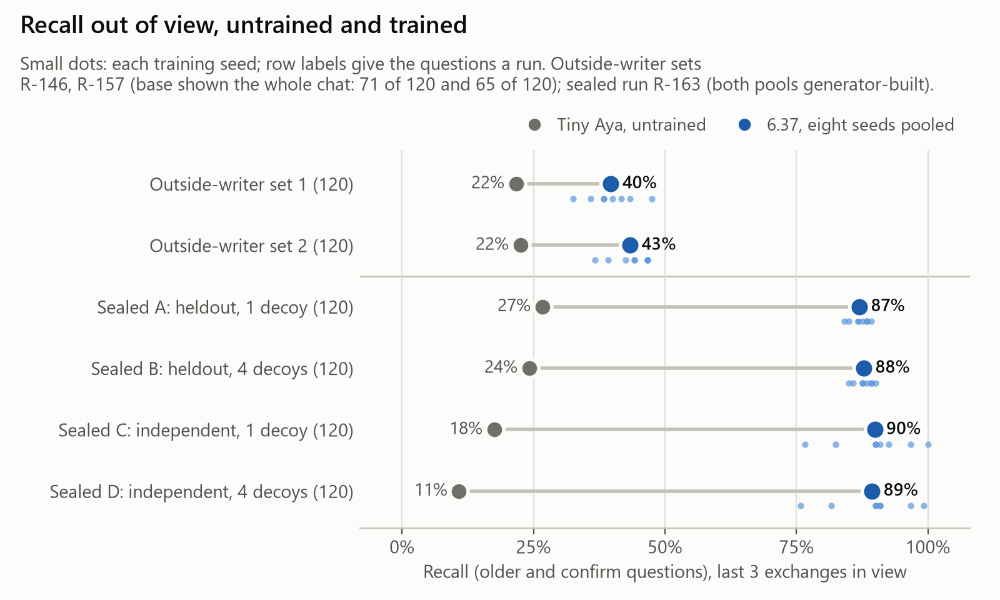
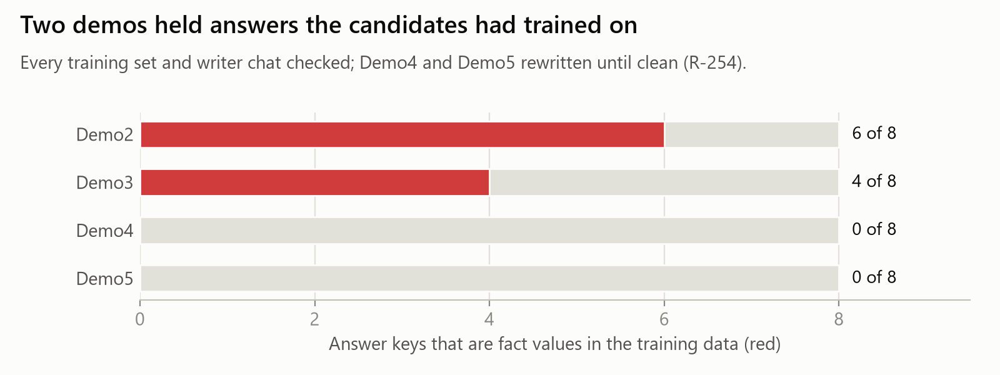
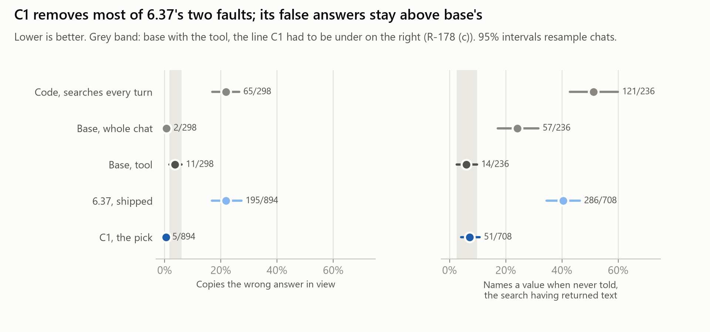

# Teaching a 3B model to search a long chat it can no longer see

*Kevin Vaillancourt · Lexsi AI Safety and Alignment Hackathon, Track 3 (Agentic Fine-tuning) · November 2026*

**Result first.** 6.37, a LoRA adapter trained with Lexsi's AgentTune, lets Tiny Aya Global (3.35B) search the part
of a chat it can no longer see. It is strong on chats from the generator that made its training chats and weak on
chats from outside it. On the generator's chats it recalls 91 to 107 of 120 facts on a
sealed test, against 13 to 32 for the untrained model with the same tool. On chats from outside
writers, the untrained model shown the whole chat recalls more, and code that searches every turn recalls as much or
more. On S3, a second sealed test from outside writers, 6.37 also repeats its own wrong answers and names values on
questions it was never told more often than the untrained model. C1, built to fix those two faults, cut both and
missed one clause of a rule fixed before S3 opened by 1.3 points, a gap S3 cannot resolve. **6.37
stays shipped** because no replacement passed the rule, not because it passed S3. C1 is published beside it, labelled.

**Use this when.** If the chat was written outside the generator and fits the context, show it whole, with no
adapter. If the chat is longer than the model's 8,192-token window, 6.37 and code that searches every
turn show no measured difference on LongMemEval-S, and code is simpler and trains nothing. If both faults matter, C1
measured far lower rates of both on S3, but it missed one registered clause and is not the shipped model.

Adapters: [aya-retrieval-6.37](https://huggingface.co/KevinVaillancourt/aya-retrieval-6.37) (shipped) and
[aya-retrieval-c1](https://huggingface.co/KevinVaillancourt/aya-retrieval-c1). The full write-up,
[docs/ARTICLE.md](https://github.com/Vee-industries/aya_retrieval/blob/main/docs/ARTICLE.md), holds every table, the
candidate ledger, the hypotheses, deviations, leakage and flow tables and the limits; code, results files and
`RECORDS.md`, the dated record (R-001 on), are in
[github.com/Vee-industries/aya_retrieval](https://github.com/Vee-industries/aya_retrieval). **Author:** I am Kevin
Vaillancourt; every research decision here is mine. **Labels:** *confirmatory* claims rest on a sealed test opened
once (the first sealed test and S3); *exploratory* ones on sets read many times or after the decision they inform.

## 1. The task and what was built

Track 3, problem statement 4: "Fine-tuning for retrieval-augmented generation: Train a model that decides when and
what to retrieve, grounds its answers in the retrieved text and ignores distracting documents." The use: a chat
assistant on a small model that must recall what a user said long ago. Tiny Aya Global takes at most
8,192 tokens, and 9 of its 36 layers attend to all of them.

The model sees the system prompt, the last three exchanges and the newest message. Everything older is reachable
only through `search_corpus`, AgentTune's SQLite full-text search (top 5 passages, up to 3 calls a
turn). The newest message is a fact told long ago (`older`), "did I tell you...?" (`confirm`), a fact in view
(`in_view`), a fact never told (`never_told`) or plain chat (`statement`). **Recall** is `older` plus `confirm`. Each
chat holds decoys: the same kind of fact about other people. **Threat model:** the adversary is the chat's own
content (decoys, a false claim in a "..., right?" question, the model's own wrong answer in view, a fact never told);
instructions hidden in retrieved passages are not tested.

6.37 is a rank-32 LoRA on all attention and MLP projections, trained on 1,094 rows whose targets are the
untrained model's own passing replies (no teacher model); settings in the long paper's section 4. AgentTune trains it
and supplies the search; CuratorKIT's grounding gate audited an ancestor set (22 of 350 rejected); AuditKIT was a
second scorer in development. Training rows come only from the generator's `train` pool (R-075); every training
step stops on a four-word run shared with a development set, and S3 shares 140 of 42,561 four-word runs with
6.37's training lines (R-179). No embedding check and no probe of the pretrained model's contamination were run.

## 2. What happened, in order

| Dates (Eastern) | Stage | Records |
|---|---|---|
| 1 to 9 Nov | Test registered before any adapter; 40 candidate sets; 6.37 frozen | R-016 to R-160 |
| 9 to 10 Nov | First sealed test passes; baselines run late; LongMemEval-S; published | R-162 to R-172 |
| 12 Nov | Demo shows two faults; deadline extended; reopened; S3 written and sealed | R-173 to R-179 |
| 12 to 14 Nov | 24 candidates listed for screening; K1.3 the pick, then C1 | R-180 to R-279 |
| 14 Nov | S3 opened once; C1 misses one clause; 6.37 stays shipped | R-280 to R-292 |
| 15 Nov | Two review panels; C1 published beside 6.37 | R-294 to R-298 |

## 3. 6.37's results

**First sealed test (confirmatory).** 300 unseen chats from the generator in each of four
conditions, run once on base and all eight seeds. Every registered rule passes: pooled recall
85.2 to 90.4% against base's 8.3 to 28.3%; every right answer came from a search that found
the fact; no adapter made more decoy retrievals than base; three judges rated every adapter coherent more often.

**The strongest baselines (exploratory, registered and run late).** On the generator's chats seed 82 is above both
code that searches every turn and the whole chat: at 58 messages, 46 to 55 of 60 against the
whole chat's 21 to 33; at 419 messages, which fit the window but could not be shown whole under this
project's 10 GB memory cap (R-166), 52, 52, 46 and 44 against code's 32, 30, 17 and 14. On two sets of chats by outside writers
(a mean of 1,400 tokens), the reading reverses:

| Outside-writer sets (set 1 / set 2) | Base, tool | Code | Base, whole chat | 6.37, tool |
|---|---|---|---|---|
| Recall, of 120 | 26 / 27 | 42 / 47 | 71 / 65 | 39 / 53 |
| Answer in view, of 40 | 36 / 34 | 13 / 16 | 35 / 32 | 35 / 37 |

Code shows no measured difference from 6.37 on recall here. 6.37 leaves answers in view alone, where code searches
every turn. Asked "..., right?" with a false claim, it corrects 1 and
3 of 20, base 1 and 0.

**LongMemEval-S (exploratory)**, outside histories far past the window: 6.37 53, base with the tool
34, code 40 of a stratified 248 of 500; against code, no measured
difference. 6.37 declines 233 of 470 answerable questions. Claude judges, not the
official GPT-4o judge.

## 4. The faults, and S3

The scripted demo, run for 6.37 on 12 November (R-175, R-176), showed two faults: asked something it was never told,
it answered with an unrelated stored fact; and it repeated its own wrong answer while that answer was in view. A hand
read of 8 never-told replies on outside set 1 that the scorer counted right found none that declined; each named
another stored fact (R-298). The deadline was then extended, and I reopened the project to fix the faults (R-177).

**The test came before the training.** S3 was written by six fresh Claude Opus writers given only a brief:
60 chats, 834 items, hashed before any new training row (R-179). It measures the copy (the model's
earlier wrong value, in view, named when answering another question) and, for the first fault, a value of the asked
category listed for the chat, named on a never-told question whose fixed keyword search returns passages (N-hit).
**The ship rule, fixed before S3 opened** (R-178, R-191): the pick must (a) beat base on recall, lose no more than 5
points on in-view, statement and plain never-told questions, and keep coherence at least base's times 0.95; (b) copy
at most half as often as 6.37 and 10 points less; (c) give at least 10 points fewer N-hit false answers than 6.37, and
no more than base. Its scorer was written after S3 started and before any S3 file was read (R-281).

## 5. The push to replace 6.37

Each candidate was registered before it was built and checked before it trained; the pick had the highest pooled
development recall among those passing 20 lines against base (R-191, R-192). Rows written ahead of time gave K1.3
(R-203). Small stages on K1.3 sat inside run-to-run variation (R-249). Demo2's and Demo3's answers were training
values, so both were retired and replaced (R-254). Training K1.3 on corrections of its own errors gave OP, and the
same stage twice gave C1.

**How C1 became the pick.** C1 failed Demo5's fixed older line. I first ruled that a candidate must beat K1.3 on each
demo, and under that ruling C1 failed (R-276, R-277); six minutes later I changed the test to the totals over both
demos (R-278), on which C1 led (5 of 12 against 4 of 12 older; 6 of 8 against
5 of 8 never-told). My reason (R-283): one demo's six older questions are too few to rank these
models. Both changes came after both models' readings existed. C1 then led K1.3 on development recall,
775 against 742 (R-279), a lead inside the seed-to-seed spread.

## 6. S3: C1 misses one clause, and 6.37 stays shipped (confirmatory)

60 chats, 6.37 and C1 pooled over three seeds:

| Measure | Base, tool | 6.37 | 6.37 seed 82 (shipped) | C1 | C1's line |
|---|---|---|---|---|---|
| Recall | 59 of 414 (14.3%) | 347 of 1,242 (27.9%) | 99 of 414 (23.9%) | 364 of 1,242 (29.3%) | (a) pass |
| Copy: names its in-view wrong value | 11 of 298 (3.7%) | 195 of 894 (21.8%) | 62 of 298 (20.8%) | 5 of 894 (0.6%) | (b) pass |
| N-hit: names a listed value of the asked category | 14 of 236 (5.9%) | 286 of 708 (40.4%) | 100 of 236 (42.4%) | 51 of 708 (7.2%) | (c) **fail**: above base |
| Never told, plain: names no listed value | 111 of 120 (92.5%) | 238 of 360 (66.1%) | 76 of 120 (63.3%) | 344 of 360 (95.6%) | (a) pass |

C1 missed (c) by 1.3 points; the chat-resampled 95% interval of C1 minus base is -3.1 to +5.7 points,
and the lines C1 passed are as unresolved (statements -4.4 points, 95% interval -10.6 to +1.7). The registered rule requires every clause, so
6.37 stays shipped. R-294 records my position that the aggregate should have decided; the registered rule was
applied. The published C1, seed 82, is under base on (c) but fails (a)'s statement line: it left only 50 of 60 (83.3%) plain statements
unsearched, -13.3 points, 95% interval -23.3 to -3.3 against base.

On S3, the whole chat recalls 274 of 414 (66.2%) and code 161 of 414 (38.9%): code recalls more than 6.37
(+11.0 points, 95% interval +3.5 to +18.6) and C1 (+9.6 points, 95% interval +2.4 to +16.6), and is worse than base and C1 on both faults. Report arms K1 and
K2.1 (two seeds, no coherence judging) meet every measured line (12 of 472 (2.5%) and 14 of 472 (3.0%) on (c)); K1.3,
the pick before C1, fails (c) like C1 (37 of 472 (7.8%)); exploratory, and no arm is swapped in.

## 7. Limits and disclosures

- **What S3's flags count.** The N-hit flag sees only values of the asked category listed for the chat; an invented
  value or another category's stored fact passes. Counting the chat's other stored facts too (exploratory, R-298):
  base 17 of 236 (7.2%), 6.37 402 of 708 (56.8%), C1 99 of 708 (14.0%), C1 seed 82 25 of 236 (10.6%). The registered never-told
  rubric asks for a decline; S3 was scored on its model-free part only, and no judge read those replies (deviation
  20).
- **Rules set after readings**, each in the long paper's deviations table: base replaced 6.37 as the standard of
  (a) after K1's development results (R-191); the demo test changed twice after both models' readings (R-276 to
  R-278); Demo5 was read twice and partly seen through a judge's marks (R-277); S3 replies were partly seen through
  the coherence judges' quotes after the marks were final (R-286).
- **Who judged.** Every judge, writer and panel lane is a Claude model, the same family as the assistant that did the
  work; the only human marker is me, not blind to the hypotheses; the coherence judges were never checked against a
  person, and no person checked S3's flags.
- Development sets were read at every candidate, so development numbers overstate the chosen candidates. One model,
  one size, English only, one 10 GB card, no chat from a real person, no second team. Not run: a general-capability
  benchmark, LoCoMo, a question-shaped router or gated code, a contamination probe (LongMemEval-S predates the model).

## 8. With more credits, reproduce, and who did what

**With more credits.** A sealed test of K1 on a new set of outside chats, under S3's rule, the result expected being
that rule's pass or fail, not a forecast; query writing trained on its own and judged the same way; LoCoMo and chats
past the window against code; a judge applying the full never-told rubric; the whole chat at 419 messages
on a larger card. The records hold no forecast of recall. The expectation in hand, exploratory: K1's S3 report arm (two seeds) recalls 253 of 828 (30.6%), copies 1 of 596 (0.2%) and names a listed value on 12 of 472 (2.5%) never-told questions, against base's 14 of 236 (5.9%); a sealed test of K1 is expected to read like that, and fails if its rate is above base's.

**Reproduce.** The README gives setup and every command; `scripts/make_article.py` fills both write-ups from results
files, except the items section 15 of the long paper lists. Training takes 33 to 35 minutes a seed on an RTX
3080; the run files hold 217 GPU hours, on my own card. Tiny Aya Global, the adapters and the data are
CC-BY-NC-4.0; the code is Apache-2.0.

**Who did what.** I directed the work and made every decision in `RECORDS.md`. Claude (Anthropic) wrote the code,
pools, training sets, tests and these write-ups and ran the experiments, as an executive-function accommodation;
other Claude agents wrote the outside-writer chats, S3, the natural training chats and the demos, and judged.
Teammates: none. Before 1 November: only the plan (R-001) and my chat engine LLE, none of it here. Thanks to Lexsi
Labs for AgentTune, AuditKIT, CuratorKIT and the hackathon, and to Cohere Labs for Tiny Aya Global. Changelog: the
long paper's.
