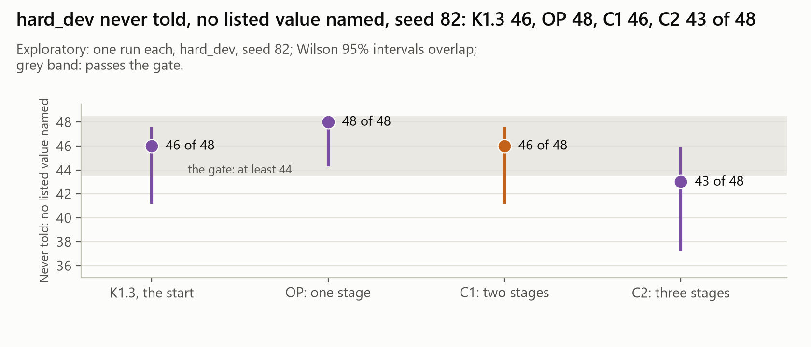
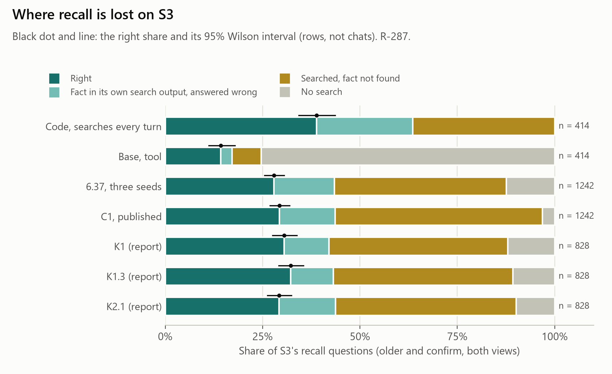

# Teaching a 3B model to search a long chat it can no longer see

*Kevin Vaillancourt · Lexsi AI Safety and Alignment Hackathon, Track 3 (Agentic Fine-tuning) · November 2026*

**Result first.** A LoRA adapter, 6.37, trained with Lexsi's AgentTune, lets Tiny Aya Global (3.35B) search the part
of a chat it can no longer see. It passed every rule of a sealed test registered before training: shown only the last
three exchanges, seed 82 recalls {{sealed_ship_range}} of {{sealed_recall_n}} out-of-view facts on unseen generated
chats, against {{sealed_shipbase_range}} for the untrained model with the same tool. A scripted demo then showed two
faults: it answered questions it was never told with unrelated stored facts, and it repeated its own wrong answer
while that answer was in view. The project was reopened to fix them. A second sealed test, S3, was sealed before any
new training row and scored by a rule fixed before it opened. The replacement, C1, removed most of both faults and
failed one clause of that rule by {{s3_gap_points}} points. **6.37 stays shipped.** On chats short enough to show whole,
the untrained model shown the whole chat recalls more than either trained model; on S3, so does code that searches
every turn.

This is the short version. The full write-up,
[docs/ARTICLE.md](https://github.com/Vee-industries/aya_retrieval/blob/main/docs/ARTICLE.md), holds every table, the
full candidate ledger, the hypotheses and deviations tables, the leakage and flow tables and the limits under fixed
headings. Code, results files and `RECORDS.md`, the dated record of every decision and run, are in
[github.com/Vee-industries/aya_retrieval](https://github.com/Vee-industries/aya_retrieval); record ids (R-164 and so
on) point into it. Adapter: [KevinVaillancourt/aya-retrieval-6.37](https://huggingface.co/KevinVaillancourt/aya-retrieval-6.37);
collections: [models](https://huggingface.co/collections/KevinVaillancourt/aya-retrieval-models-6af35d3c521e8481db061df5)
and [datasets](https://huggingface.co/collections/KevinVaillancourt/aya-retrieval-datasets-6af35d3cf9a91556f52af373).
The adapter and datasets are public and not gated; the base model is gated, so accept its licence first. Every
table and result number below is filled from results files by `scripts/make_article.py`, except the few typed from the
record that the long paper's section 15 lists.

**Problem statement.** Track 3, Agentic Fine-tuning, problem statement 4: "Fine-tuning for retrieval-augmented
generation: Train a model that decides when and what to retrieve, grounds its answers in the retrieved text and
ignores distracting documents."

**Author.** I am Kevin Vaillancourt. Every research decision here is mine; `RECORDS.md` dates each one.

**Claim labels.** *Confirmatory* claims rest on a sealed test opened once (the first sealed test, S3). *Exploratory*
claims rest on development sets read many times or on sets read after the decision they inform.

## 1. The task and what was built

A chat runs long; the model sees the system prompt, the last three exchanges and the newest message. Everything
older sits behind one tool, `search_corpus`, AgentTune's SQLite full-text search (top {{top_k}} passages, up to
{{max_calls}} calls a turn). The newest message is one of five kinds: a fact told long ago (`older`), "did I tell
you...?" (`confirm`), a fact still in view (`in_view`), a fact never told (`never_told`, the right reply declines),
or plain chat (`statement`, the right move is not to search). **Recall** is `older` plus `confirm`. Each chat holds
decoys: the same kind of fact about other people.

6.37 is a rank-32 LoRA on all attention and MLP projections, trained by supervised fine-tuning on
{{training_rows}} rows. Targets are the untrained model's own replies where they pass the scorer, so the adapter keeps
the model's voice; loss falls only on the taught turns (R-076). Eight training seeds; seed 82 was named to ship before
most of them existed and frozen with the scorer and judge before the sealed run (R-141, R-160). Settings:
{{training_setup}}. Base `CohereLabs/tiny-aya-global` at revision `af89d219b53ed9b13b8a4645f9c8028973510324`, in
bfloat16, CC-BY-NC-4.0. No teacher model and no closed-model baseline; judges and writers are Claude agents.

**How the Lexsi toolkits connect.** A build script writes the rows; CuratorKIT's grounding gate audited an ancestor
set's found-fact answers and rejected {{curator_v6}}, and the replacements it passed are in 6.37's lineage.
AgentTune's distillation trainer fits the LoRA, and AgentTune's SQLite search is the tool in every training row, test
and demo. The harness runs the search loop and the project's scorer marks each reply. AuditKIT was a second scorer in
development (agreed {{auditkit_agree}} on v3); its paired bootstrap does not centre its resamples (long paper, section
10).

**Data, splits and leak checks.** Training rows come only from the `train` and `wide` pools ({{training_rows}} rows in
6.37's set). Development: `probe` and `hard_dev`, read many times. The first sealed test: `heldout` and `independent`,
{{sealed_conversations}} chats a condition, run once. Outside-writer sets 1 and 2: {{ow_chats}} chats and {{ow_items}}
questions a set, by fresh Claude Opus agents. S3: {{s3_chats}} chats and {{s3_items}} items, run once. No training row
comes from a test set; every training step stops on a four-word run shared with `probe` or `hard_dev` (R-055, R-110);
S3 shares {{s3_runs_shared}} four-word runs with 6.37's training lines, counted and not removed (R-179). No embedding
or MinHash check was run, and the pretrained model was not probed for contamination. The long paper's section 3 has
the leakage table by type and S3's flow table. English only. Every question's trajectory (the searches, what each
returned, the reply and the verdict) is in the run files and the `aya-retrieval-eval-logs` dataset.

**Metrics.** Higher is better for recall, `in_view`, `never_told`, statements left unsearched, right search decisions
and coherence; lower is better for false retrieval, copies of a wrong answer in view, N-hit false answers and seconds a
question (long paper, section 5).

## 2. What happened, in order

| Dates (Eastern) | Stage | Records |
|---|---|---|
| 1 to 9 Nov | Test registered before any adapter; {{ledger_total}} candidate sets; 6.37 frozen | R-016 to R-160 |
| 9 to 10 Nov | First sealed test passes; baselines run late; LongMemEval-S; published | R-162 to R-172 |
| 12 Nov | Demo shows two faults; deadline extended; reopened; S3 written and sealed | R-173 to R-179 |
| 12 to 14 Nov | {{reopened_n}} candidates listed for screening, {{reopened_full}} read on every line; K1.3 the pick, then C1 | R-180 to R-279 |
| 14 Nov | S3 opened once; C1 fails one clause; 6.37 stays shipped | R-280 to R-287 |

## 3. 6.37's results

**First sealed test (confirmatory).** {{sealed_conversations}} unseen generated chats in each of four conditions (two
pools, one or four decoys a chat), run once on base and all eight seeds. Every registered rule passes in every
condition: pooled recall {{sealed_adapters_range}}% against base's {{sealed_base_range}}%; every right answer came
from a search that found the fact; no adapter made more false retrievals than base; every adapter was judged coherent
more often than base by all three judges (R-163).

**The strongest baselines (exploratory).** Two references registered before training were run late (R-167 to R-169):
code that searches every turn, and base shown the whole chat. On the generated sealed chats seed 82 is far above both
(code {{r168_as}} of {{r168_recall_n}} against seed 82's {{r168_ship}}). On two sets of chats by outside writers,
Claude Opus agents who never saw the generator (about {{ow_tokens_mean}} tokens a chat), the reading reverses:

| Outside-writer sets (set 1 / set 2) | Base, tool | Code | Base, whole chat | 6.37, tool |
|---|---|---|---|---|
| Recall, of {{as_recall_n}} | {{ow_base_recall_1}} / {{ow_base_recall_2}} | {{as_recall_1}} / {{as_recall_2}} | {{wc_recall_1}} / {{wc_recall_2}} | {{ow_82_recall_1}} / {{ow_82_recall_2}} |
| Answer in view, of {{as_kind_n}} | {{ow_base_in_view_1}} / {{ow_base_in_view_2}} | {{as_in_view_1}} / {{as_in_view_2}} | {{ow_wc_in_view_1}} / {{ow_wc_in_view_2}} | {{ship_in_view_1}} / {{ship_in_view_2}} |
| Never told, of {{as_kind_n}} | {{ow_base_never_told_1}} / {{ow_base_never_told_2}} | {{as_never_told_1}} / {{as_never_told_2}} | {{ow_wc_never_told_1}} / {{ow_wc_never_told_2}} | {{ship_never_told_1}} / {{ship_never_told_2}} |

When the chat fits, show it whole. Code recalls as well as 6.37 and is faster; training's gain is when to search:
6.37 searches for facts out of view and leaves answers in view alone, where code searches every turn.

**LongMemEval-S (exploratory)**, an outside set with histories far longer than the model's context: 6.37 is judged
right on {{lme_j_ship}} of {{lme_judged_n}} judged questions, base with the tool on {{lme_j_base}} and code on
{{lme_j_code}}; but 6.37 declines {{lme_refuse_ship}} of {{lme_answerable_n}} answerable questions (R-170). These are
Claude judges, not the official GPT-4o judge.

## 4. The faults, and why the project reopened

A blind rubric read of the write-ups asked for evidence a judge could see, so the scripted demo was run for 6.37 for
the first time on 12 November (R-173, R-175). On two of its four questions 6.37 searched with queries copied from its
training set and answered with an unrelated stored fact. On eight more questions, written blind and registered
before they ran, 6.37 repeated its own wrong answer, still in view, on six (R-176).

The deadline was then extended. I reopened the project: the demo showed results I had missed, and the extra day
gave enough time to train further (R-177). 6.37 and every result about it stayed published.

**The test came before the training.** S3 was written by {{s3_writers}} fresh Claude Opus writers, given only a
brief: {{s3_chats}} chats, {{s3_items}} items. Nobody read a chat; the set, loader, scorer and judge brief were hashed before
any new training row existed (R-179, R-181). S3 measures the two faults directly: with the model's own earlier wrong
answer placed in view, does it copy it; and on a never-told question whose search returns passages, does it name a
value. **The ship rule, fixed before S3 opened** (R-178, R-191): the pick must (a) beat base on recall, with no more
than 5 points lost on in-view, statement and plain never-told questions and coherence no lower than base's minus 5%;
(b) copy at most half as often as 6.37 and 10 points less; (c) give at least 10 points fewer N-hit false answers than
6.37, and no more than base.

## 5. The push to replace 6.37, then K1.3

Each candidate was registered before it was built and checked before it trained. Seed 82 had to clear `hard_dev`
(never-told at least 44 of 48) and a demo, a fresh chat with 12 blind questions, before more seeds trained; survivors
were screened on 20 lines against base, and the pick had the highest pooled recall over three seeds (R-191, R-192).
Candidates were tried until one beat the pick or the time ran out (R-240).

1. **Rows written ahead of time** (K1 to K4.9). K1.3, K1 with each fact in other wordings, passed every line and
   became the pick (pick recall {{pick_recall_k13}}, R-203). Natural chats from writer agents raised outside-writer
   recall, but every one that trained failed a demo or a screening line.
2. **Small stages on K1.3.** R2c beat K1.3 ({{pick_recall_r2c}}), but its set had skipped the checker, and the same
   recipe on 10 fewer rows failed: its passes were inside run-to-run variation (R-247, R-249). Since those
   passes could be lucky draws, I moved to a different approach (R-253).
3. **The demos were contaminated.** Demo2's and Demo3's answers turned out to be fact values in the training chats:
   the demo writers and the training-chat writers chose the same "uncommon" values (R-254). Both were retired; Demo4
   and Demo5 were rewritten until a check against all training data came back clean.

   

4. **The model's own mistakes.** OP trained K1.3 on corrections of its own errors; C1 is OP's stage run twice. Each
   repeat declined fewer never-told questions (OP {{hd_nt_op}}, C1 {{hd_nt_c1}}, C2 {{hd_nt_c2}} of 48; exploratory, one
   run each at one seed, the 95% intervals overlap), and most of
   OP's remaining errors were searches that never found the fact, which corrections of reading cannot reach (R-267).

   

**How C1 became the pick.** C1 passed Demo4 and failed Demo5's fixed older line. I changed the test: a candidate must beat
K1.3, judged on the totals over both demos (R-276, R-278): older {{demos_c1_older}} for C1 against
{{demos_k13_older}} for K1.3, never-told {{demos_c1_never_told}} against {{demos_k13_never_told}}. My reason (R-283):
the results on one demo were too poor to judge by; K1.3 alone scored {{demo4_k13_older}} on Demo4 and {{demo5_k13_older}} on Demo5,
two demos from one brief. C1 then passed all 20 screening lines and led K1.3 on pick recall, {{pick_recall_c1}}
against {{pick_recall_k13}} (R-279), a lead under two seeds' spread.

## 6. S3: C1 fails one clause, and 6.37 stays shipped (confirmatory)

S3 ran once (R-280); its scorer was fixed and tested on planted results before any S3 file was read
(R-281, R-282). Raw counts, {{s3_chats}} chats, 6.37 and C1 pooled over three seeds:

| Measure | Base, tool | 6.37 | C1 | Line |
|---|---|---|---|---|
| Recall | {{s3_recall_base}} | {{s3_recall_637}} | {{s3_recall_c1}} | (a) pass |
| Copies its wrong answer in view | {{s3_copy_base}} | {{s3_copy_637}} | {{s3_copy_c1}} | (b) pass |
| Names a value, never told, search returned text | {{s3_nhit_base}} | {{s3_nhit_637}} | {{s3_nhit_c1}} | (c) **fail**: above base |
| Declines a plain never-told question | {{s3_ntp_base}} | {{s3_ntp_637}} | {{s3_ntp_c1}} | (a) pass |

Coherence, judge 1 deciding, of {{s3_coh_n}}: {{s3_coh_j1}} (R-286). Every other line passes.

Against 6.37, C1's copies changed by {{s3_rel_copy}}, its N-hit false answers by {{s3_rel_nhit}}, and its declines
of plain never-told questions by {{s3_rel_ntp}}; the two models' recall falls within each other's 95% intervals. It missed clause (c) because its
false-answer rate was {{s3_gap_points}} points above the untrained model's. A miss by one line is a miss, so by the
registered rule 6.37 stays shipped and S3's numbers on 6.37 are its measured weakness.

**The strongest baselines on S3** (reported beside the rule). S3's chats fit whole. Base with the whole chat recalls
{{s3_recall_wc}} and code {{s3_recall_as}}, both above 6.37 and C1. Code pays on everything else: it copies a wrong
answer in {{s3_copy_as}} and names a value on {{s3_nhit_as}} never-told questions.

**Where recall is lost.** Of C1's wrong recall answers, {{s3_missed_c1}} were searches that never found the fact. The
reopening trained reading and declining; the query, the fault left untrained, is now the largest loss.

## 7. Limits and disclosures

- **Disclosed: the demo rule changed after the readings.** I made the changes of R-276 and R-278 after both
  models' Demo4 and Demo5 readings existed; my reason is R-283.
- **Disclosed: Demo5 was read twice** (C1, then K1.3) and partly seen by the orchestrator through a judge's marks
  (R-277).
- **Disclosed: S3 replies were partly seen** through short quotes in the coherence judges' reports, after the marks
  were final (R-286).
- **Disclosed: every judge, writer and panel lane is a Claude model**, the same family as the assistant that did the
  work; the only human marker is me, not blind to the hypotheses. The coherence judges were never checked against a
  person.
- Development sets were read many times: {{reopened_n}} listed candidates ({{reopened_full}} read on every line) in the reopened work alone, so development numbers
  flatter what was chosen; the claims rest on the two sealed tests.
- One model, one size, English only, greedy decoding, one 10 GB card; no chat from a real person; no second team has
  rerun it; contamination of the pretrained model was not probed.

## 8. Next, reproduce, and who did what

**Next.** Train query writing, the fault the reopening left untrained, and judge it on a new sealed set; measure the
whole chat on chats too long to fit; test instructions hidden in retrieved passages.

**Reproduce.** The README gives setup and every command; `scripts/make_article.py` builds both write-ups from results
files, and `scripts/make_figures.py` draws every figure. Training takes {{train_minutes}} minutes a seed on an RTX
3080; the run files hold {{gpu_total}} hours of GPU time in all, on my own card, so the compute cost is $0. Tiny Aya Global is CC-BY-NC-4.0, and the adapter and data carry that licence; the code is Apache-2.0.

**Who did what.** I directed the work and made every decision in `RECORDS.md`. Claude (Anthropic)
wrote the code, pools, training sets, tests and these write-ups and ran the experiments, as an executive-function
accommodation; other Claude agents wrote the outside-writer chats, S3, the natural training chats and the demos, and
judged coherence and LongMemEval-S. Teammates tagged: none. Work before 1 November: only the plan (R-001) and the
my chat engine LLE, none of which is in this repository. Thanks to Lexsi Labs for AgentTune, AuditKIT,
CuratorKIT and the hackathon, and to Cohere Labs for Tiny Aya Global.

**Changelog.** 10 November: the first published version, 6.37, both datasets and the write-up (R-171, R-172). 12 to
14 November: reopened to fix two faults; S3 written and sealed;
candidates screened; C1 picked and run on S3; C1 failed one clause and 6.37 stays shipped; both write-ups rebuilt from
results files. The long paper's changelog has each step's records.

**Where each required item is.**

| Item | Here | Long paper |
|---|---|---|
| Claim, headline, base model and method | top, section 1 | summary |
| Problem statement and why this problem | top | summary, section 1 |
| Toolkits and how they connect | section 1 | sections 4 and 10 |
| Data, sizes, splits, languages, leak checks | section 1 | section 3 |
| Tool environment and trajectories | section 1 | section 3 |
| Hyperparameters, models and licences | section 1 | section 4 |
| Metrics and their direction | section 1 | section 5 |
| Hypotheses and outcomes | sections 3, 4 and 6 | section 5 |
| Results, seeds, intervals, baselines | sections 3 and 6 | sections 6 and 9 |
| Ablations: every candidate | section 5 | section 8 |
| Compute and cost | section 8 | section 10 |
| Deviations | section 7, the disclosures | section 11 |
| Limits | section 7 | section 12 |
| Errors and negative results | sections 4 to 6 | sections 7, 8, 13 |
| Future work | section 8 | section 14 |
| Reproduce | section 8 | section 15 |
| Declaration, contributions, LLM usage, team | section 8 | after section 15 |
